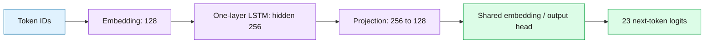
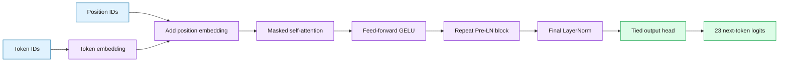

# BioLM Studio: Training, Models, Evaluation, and Dashboard

This guide explains how the repository trains autoregressive protein language models, how its model architectures work, what the evaluation metrics mean, and how the dashboard gets its data.

It describes the implementation in this repository. Generated sequences and sequence checks are research outputs and heuristic diagnostics; they are not evidence of experimentally validated binding, folding, or solubility.

## 1. Project at a glance

The neural models learn to predict the next amino-acid token from the tokens that came before it. Once trained, they can generate a sequence one residue at a time. The project compares two neural language models with a simple statistical baseline:

| Model | Main idea | What it provides |
|---|---|---|
| LSTM | Reads the sequence from left to right while carrying a recurrent hidden state | Compact autoregressive baseline |
| Causal Transformer | Uses masked self-attention so each position sees only earlier positions | Neural model with direct access to earlier context |
| Bigram | Estimates the next-token distribution from only the previous token | Small, interpretable statistical baseline |

The training and evaluation utilities are shared by the command-line scripts and notebooks. Data, checkpoints, and run results are normally kept outside Git; dashboard-ready summaries are stored in `dashboard/data.json`.

## 2. Dataset and token representation

### Dataset context

The repository documents two different biological datasets. They should not be mixed when interpreting model results:

| Dataset | Role | Biological material |
|---|---|---|
| OAS `1287151_1_Paired_All.csv` | Historical Sprint 1 work | About 17.4k conventional human heavy-chain VH sequences |
| NCBI SRA `SRR3544218` | BioLM Studio Sprint 2/3 models and dashboard | Camelid VHH single-domain antibody sequences; project documentation reports about 242k sequences |

The dashboard identifies SRR3544218 as its source. Claims about VHH framework hallmarks are intended for the camelid VHH dataset, not for the historical human VH set. Always check a run's `data_version`, configuration, and dataset metadata before comparing it.

### Tokenizer

`AminoAcidTokenizer` maps the 20 uppercase standard amino acids to IDs 0–19, then adds three special tokens:

| Token IDs | Meaning |
|---|---|
| 0–19 | `ACDEFGHIKLMNPQRSTVWY` |
| 20 | `<PAD>`: batch padding |
| 21 | `<BOS>`: beginning of sequence |
| 22 | `<EOS>`: end of sequence |

An input sequence is encoded as `<BOS> residues <EOS>`. There is no unknown-residue token: invalid characters are rejected. Sequences are right-padded within each batch.

## 3. Training pipeline

### End-to-end flow

```mermaid
flowchart LR
    A[Raw antibody sequences] --> B[Clean, filter, deduplicate]
    B --> C[Train / validation / test CSV splits]
    C --> D[Tokenizer: 20 amino acids + BOS, EOS, PAD]
    D --> E[Batch, right-pad, shift inputs and targets]
    E --> F{Model}
    F --> G[LSTM language model]
    F --> H[Causal Transformer]
    F --> I[Bigram baseline]
    G --> J[Next-token cross-entropy]
    H --> J
    I --> K[Validation nats and perplexity]
    J --> K
    K --> L[Best and last checkpoints + run history]
    L --> M[Sequence generation and evaluation]
    M --> N[JSON / FASTA results]
    N --> O[Dashboard]

    classDef data fill:#e0f2fe,stroke:#0369a1,color:#1c1917;
    classDef process fill:#dcfce7,stroke:#16a34a,color:#1c1917;
    classDef model fill:#f3e8ff,stroke:#7e22ce,color:#1c1917;
    classDef metric fill:#fef3c7,stroke:#b45309,color:#1c1917;
    classDef artifact fill:#f5f5f4,stroke:#78716c,color:#1c1917;
    class A,B,C,D,E data;
    class F,G,H,I model;
    class J,K metric;
    class L,M,N,O process;
```



### Preparing the batches

For each tokenized sequence, the training loop forms an input and a one-token-shifted target:

```text
tokens:  <BOS>  A  C  D  <EOS> <PAD>
input:   <BOS>  A  C  D  <EOS>
target:  A      C  D  <EOS> <PAD>
```

The model predicts the target at every position. `<PAD>` targets are ignored by the loss. `<EOS>` is included in the targets, while `<BOS>` is not predicted. This convention is shared with the bigram baseline so their validation losses use the same token accounting.

### Optimization and checkpointing

The shared training loop in `training.py` does the following:

1. Loads the training and validation CSVs for a data version.
2. Builds the selected preset and shuffled training batches.
3. Optimizes with AdamW and cross-entropy loss.
4. Uses linear learning-rate warmup followed by cosine decay.
5. Clips gradient norm to 1.0. Optional mixed precision is enabled on CUDA unless `--no-amp` is used.
6. Computes token-weighted train and validation nats/perplexity at each epoch.
7. Saves `best.pt` when validation nats improve and `last.pt` for resuming.
8. Stops after the configured patience without validation improvement.

The default command-line training arguments are 15 epochs, batch size 128, seed 42, weight decay 0.01, warmup 100 steps, and patience 3. The learning-rate defaults are `1e-3` for LSTM and `6e-4` for Transformer. The actual run configuration is more authoritative than these defaults because CLI options can override them.

Useful commands from the repository root:

```powershell
# Quick local smoke run on toy data
python scripts/make_toy_data.py
python scripts/train.py --preset tf_small --epochs 3 --max-train 100

# Train the documented real data version (data must already be available)
python scripts/train.py --preset tf_small --data-version SRR3544218 --run-name tf-small-srr

# Fit the bigram baseline on the same processed split
python scripts/run_baseline.py --data-version SRR3544218
```

Toy data checks that code runs; it is not suitable for biological conclusions.

## 4. Model architectures

### LSTM language model

The LSTM embeds each input token, processes positions in order, projects the hidden state to the embedding dimension, then predicts the next token. The output head shares its weight matrix with the token embedding (weight tying).



The default `lstm` preset uses a 128-dimensional embedding, 256 hidden units, and one recurrent layer. Because the LSTM reads left to right, its hidden state summarizes the preceding sequence context.

### Causal Transformer

The Transformer adds learned token and positional embeddings, applies multiple Pre-LayerNorm Transformer encoder blocks with a causal attention mask, applies a final layer norm, and predicts the next token. The output matrix is tied to the token embedding matrix.



The causal mask blocks attention to future positions, preserving autoregressive prediction. Presets in `training.py` are `tf_small` (128 embedding, 4 heads, 4 layers, 512 feed-forward width) and `tf_base` (256 embedding, 8 heads, 6 layers, 1024 feed-forward width). The training code reserves up to 200 positions; it checks sequence length rather than silently truncating it.

### Bigram baseline

`BigramLM` counts adjacent token transitions in the training sequences and applies Laplace smoothing (`alpha=1` by default). It predicts from only the previous token, not the full sequence history. It is a useful sanity baseline, not a neural architecture.

## 5. Generation and sampling

Generation begins with `<BOS>` and an optional amino-acid prompt. At every step, the model predicts a distribution for the next token. The generator masks `<PAD>` and `<BOS>` so they cannot be sampled, stops a sequence on `<EOS>`, and returns whether each sequence ended before the maximum length. If a prompt is provided, its residues count toward `max_len`.

Four evaluation configurations are defined in `scripts/evaluate_generation.py`:

| Strategy | Temperature | Filtering | General effect |
|---|---:|---|---|
| Greedy | 1.0 | Argmax | Deterministic; useful to expose mode collapse |
| Top-k 10 | 0.8 | Keep up to 10 highest-logit tokens | Restricts choices and tends toward more conservative sampling |
| Nucleus p=0.95 | 1.0 | Keep the smallest set whose cumulative probability reaches 0.95 | Adapts the number of candidate tokens to the distribution |
| Nucleus p=0.80 | 1.2 | Keep cumulative probability mass 0.80 | More exploratory temperature with a narrower probability mass |

Temperature rescales logits before filtering and sampling. A fixed seed makes the run reproducible under the same code, device, and batching setup; generation uses a distinct seed per batch.

The dashboard generator sends its settings to `/api/generate`. The server tries a local PyTorch checkpoint first. If that is unavailable or fails, it can return precomputed samples or a Markov fallback. Check the returned `backend` before treating an output as a live neural sample.

## 6. Metrics and how to read them

### Training and language-model metrics

| Metric | Definition | How to read it | Main limitation |
|---|---|---|---|
| Nats per token | Total target negative log-likelihood divided by non-padding target-token count | Lower is better for next-token prediction | Predictive fit does not establish biological function |
| Perplexity (PPL) | `exp(nats per token)` | Lower means less predictive uncertainty under the test distribution | Compare only with the same token convention and data split |
| Validation loss | Loss on the validation split during training | Used to select `best.pt` and monitor overfitting | It is not an independent final test score |

The uniform baseline over 20 amino acids has PPL 20 (`ln(20)` nats). Because the model vocabulary also contains special tokens, do not confuse `ln(20)` with `ln(23)`; training evaluation ignores padding targets and the baseline constrains its predicted next tokens to 20 amino acids plus EOS.

### Generated-sequence metrics

| Metric | Current implementation | Interpretation and caveat |
|---|---|---|
| Validity rate | Fraction within configured length bounds and containing only the 20 standard uppercase amino acids | Alphabet/length compliance only; it does not certify folding or function |
| Uniqueness rate | Number of distinct sequences divided by total generated sequences | Low values reveal duplicates; 100% uniqueness alone does not mean high quality |
| Levenshtein diversity | Mean normalized edit distance across sampled pairs | Larger values mean more sequence-level difference; up to 500 random pairs are sampled by default |
| 3-mer Jaccard similarity | Mean set Jaccard overlap of 3-mers for pairs within the generated batch | Measures intra-batch motif overlap, not generated-vs-natural overlap. `compute_reference_kmer_overlap` exists separately and reports the fraction of generated 3-mers found in supplied reference sequences; it is not the same metric |
| Amino-acid composition KL | `D_KL(P_generated || P_reference)` with Laplace smoothing and explicit normalization | Zero means matching marginal frequencies; larger means more composition shift. It ignores residue order and motif context |
| Novelty rate | Fraction absent as an exact string from the loaded training set | `null` / N/A if the reference train set is unavailable; exact novelty does not detect near-duplicates |
| GRAVY | Mean Kyte–Doolittle hydropathy across residues, then averaged across sequences | A coarse global physicochemical descriptor, not an experimental solubility assay |
| Net charge | Approximate residue-count charge: K/R positive, D/E negative, H approximated as +0.1 | `ph` is accepted by the function but the current formula does not implement residue-specific Henderson–Hasselbalch titration |
| Canonical cysteine rate | For sequences at least 70 residues long, checks first C in positions 18–26 and last C in positions 88–115 (1-indexed); shorter sequences fall back to count >= 2 | A positional sequence heuristic, not proof that a disulfide bond forms or that the fold is correct |
| Mean length | Arithmetic mean number of decoded amino acids | Useful alongside length validity; inspect the full distribution when possible |

In code, the generated-batch metric is named `kmer_jaccard_similarity`. Do not label that value as reference-corpus overlap. The separate `compute_reference_kmer_overlap` function must be given real reference sequences to measure that question.

### Single-sequence QC annotations

`analyze_vhh_sequence()` reports length, validity, cysteine positions, an FR2 motif match, an approximate CDR3 segment, GRAVY, charge, and a rule-based score. These are **heuristic annotations**. The code does not run ANARCI/IMGT numbering, structural prediction, binding prediction, or an experimental solubility assay. Treat the score as a quick inspection aid, not a calibrated probability or quality ranking.

## 7. Evaluation workflow and outputs

Run generation evaluation from a trained checkpoint:

```powershell
python scripts/evaluate_generation.py --model-id transformer-notebook-srr --n-seqs 100 --seed 42
```

The script generates one batch for each sampling strategy, evaluates each batch, writes FASTA files under `results/generated/<model-id>/`, and writes a JSON report under `results/evaluations/`. The report includes dataset/sampling metadata, the number of generated sequences, seed, whether training data loaded for novelty, summary metrics, sample sequences, and FASTA path.

To regenerate dashboard benchmark data from run histories and baseline JSON files:

```powershell
python scripts/export_dashboard_data.py
```

The exporter reads `results/runs/*/{config,metrics,history,test_metrics}.json/csv` and baseline JSON files, then writes `dashboard/data.json`. It supports loading `test_metrics.json` when such a file exists. The shared training entry point trains and evaluates on train/validation splits; verify that a held-out `test_metrics.json` was actually produced before describing a dashboard value as test-set performance.

For uncertainty estimates, repeat generation with multiple seeds and report variation across runs. A single set of 50 or 100 sequences is a descriptive sample, not a precise estimate of the model's full generation distribution.

## 8. Dashboard: layout, colors, and data flow

### Main areas

| Area | What it shows |
|---|---|
| Model benchmark | Summary KPI cards, model/baseline comparison table, training convergence chart |
| Live generator | Model and prompt controls, sampling settings, generated sequence with colored regions, heuristic QC cards, session history |
| Sampling matrix | Per-strategy validity, uniqueness, edit diversity, 3-mer overlap, KL, novelty, GRAVY, sample sequence, FASTA download |
| Method guide | Metric rationale, amino-acid and sampling charts, and interactive explanations |

### Dashboard palette

The dashboard keeps a warm stone background and uses accents to group meaning. The exact tokens are in `dashboard/styles.css`.

| Color | Hex examples | Dashboard role |
|---|---|---|
| Stone background | `#FAFAF9`, cards `#FFFFFF` | Main page and surfaces |
| Dark stone text | `#1C1917`, `#292524` | Headings and body copy |
| Emerald green | `#16A34A`, pale `#DCFCE7` | Brand, positive/status accents |
| Blue | `#0369A1`, pale `#E0F2FE` | Sequence-region or informational accents |
| Purple | `#7E22CE`, pale `#F3E8FF` | Structural/diagnostic category |
| Amber | `#B45309`, pale `#FEF3C7` | Hydropathy and caution-style category |
| Rose | `#BE123C`, pale `#FFE4E6` | Warnings such as greedy mode collapse |

Inter is used for interface text; JetBrains Mono is used for numeric values and sequence-like content. Tables are placed in horizontally scrollable wrappers at narrow widths. The generator layout collapses to one column on smaller screens.

### How the dashboard loads and renders

```mermaid
flowchart LR
    A[results runs, histories, baselines] --> B[export_dashboard_data.py]
    C[Generation evaluation JSON] --> D[evaluate_generation.py dashboard merge]
    B --> E[dashboard/data.json]
    D --> E
    E --> F[Browser app.js fetches JSON]
    F --> G[KPIs, tables, and charts]
    H[serve_dashboard.py] --> I[/api/health and /api/generate]
    F --> I
    I --> J[PyTorch checkpoint when available]
    I --> K[precomputed or Markov fallback]
    J --> L[Sequence + backend + heuristic QC]
    K --> L

    classDef files fill:#f5f5f4,stroke:#78716c,color:#1c1917;
    classDef script fill:#dcfce7,stroke:#16a34a,color:#1c1917;
    classDef browser fill:#e0f2fe,stroke:#0369a1,color:#1c1917;
    classDef api fill:#f3e8ff,stroke:#7e22ce,color:#1c1917;
    classDef fallback fill:#fef3c7,stroke:#b45309,color:#1c1917;
    class A,C,E files;
    class B,D script;
    class F,G browser;
    class H,I,J,L api;
    class K fallback;
```

The frontend loads `dashboard/data.json` and renders tables and charts. The local server exposes `/api/health`, `/api/data`, `/api/generate`, and checkpoint upload. The status pill reports server availability; it should not be taken by itself as proof that a particular model checkpoint was used. The generation response's `backend` field is the better provenance signal.

The dashboard includes views built from exported data and some chart/benchmark values maintained in the frontend. Before presenting a figure as a measured result, confirm it traces to the relevant run or evaluation JSON. In particular, inspect whether a displayed value is dynamic, hard-coded for illustration, validation-derived, or backed by a held-out test report.

## 9. Reproducibility and interpretation checklist

Before sharing a result, record/check:

- Dataset identity, organism/type (VH vs VHH), processed data version, and split sizes.
- Model preset and full saved configuration, checkpoint/run ID, seed, batch size, and device.
- Whether the score is train, validation, or held-out test; do not use these labels interchangeably.
- Number of generated sequences and sampling parameters for each comparison.
- Whether novelty had a real training reference loaded; report N/A if not.
- Whether a 3-mer score is intra-generation similarity or overlap against a supplied natural reference.
- Whether displayed dashboard values come from current JSON or fixed frontend values.
- That heuristic QC is not a structure, binding, or solubility validation.

### Core code map

| File | Responsibility |
|---|---|
| `utils.py` | Tokenizer, padding, splits/path helpers, common loss conversions |
| `models.py` | LSTM and causal Transformer definitions |
| `training.py` | Presets, model construction, train/validation loop, checkpoints |
| `scripts/train.py` | Training CLI |
| `ngram.py`, `scripts/run_baseline.py` | Bigram baseline and CLI |
| `sampling.py` | Greedy, temperature, top-k, and nucleus generation |
| `evaluation.py` | Batch metrics and single-sequence heuristic diagnostics |
| `scripts/evaluate_generation.py` | Sampling benchmark, FASTA and evaluation JSON output |
| `scripts/export_dashboard_data.py` | Combine run histories and baselines into dashboard JSON |
| `dashboard/index.html`, `dashboard/styles.css`, `dashboard/app.js` | Dashboard structure, styling, and browser behavior |
| `scripts/serve_dashboard.py` | Local static server and generation API |

