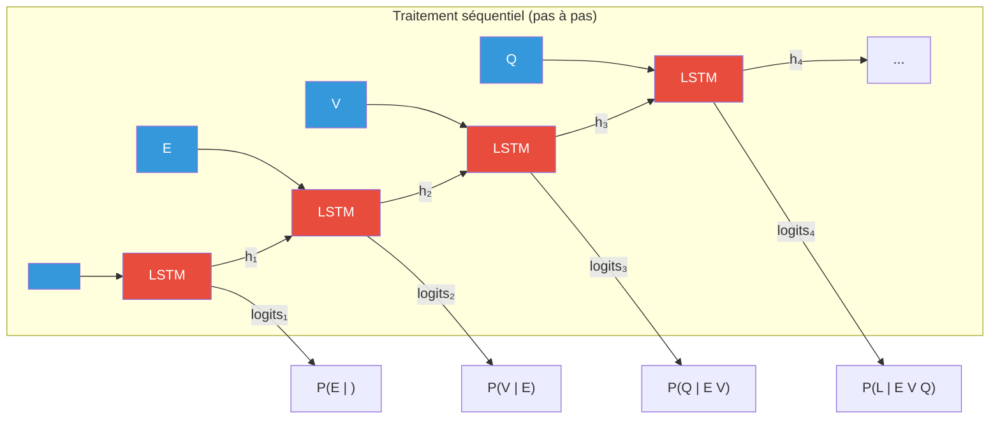
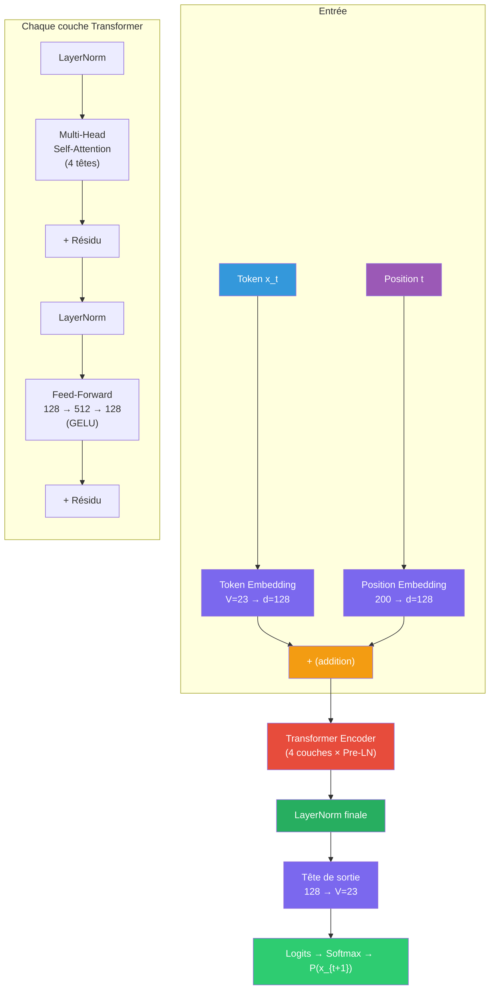
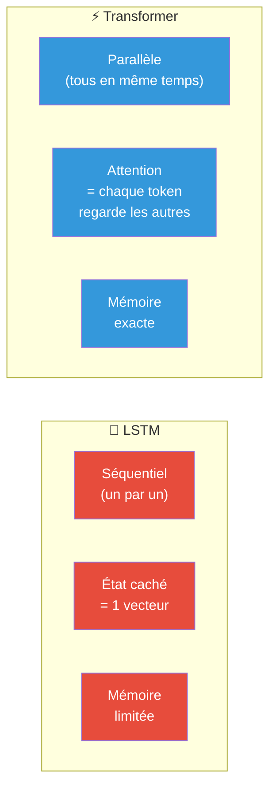
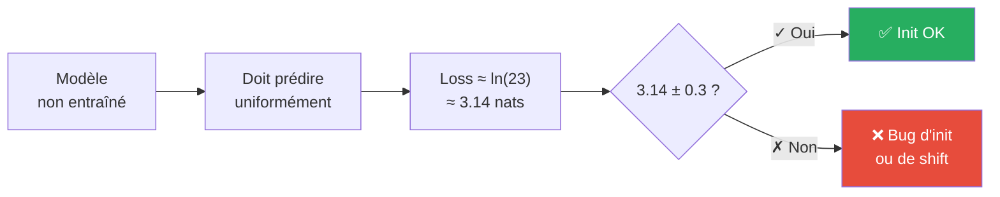
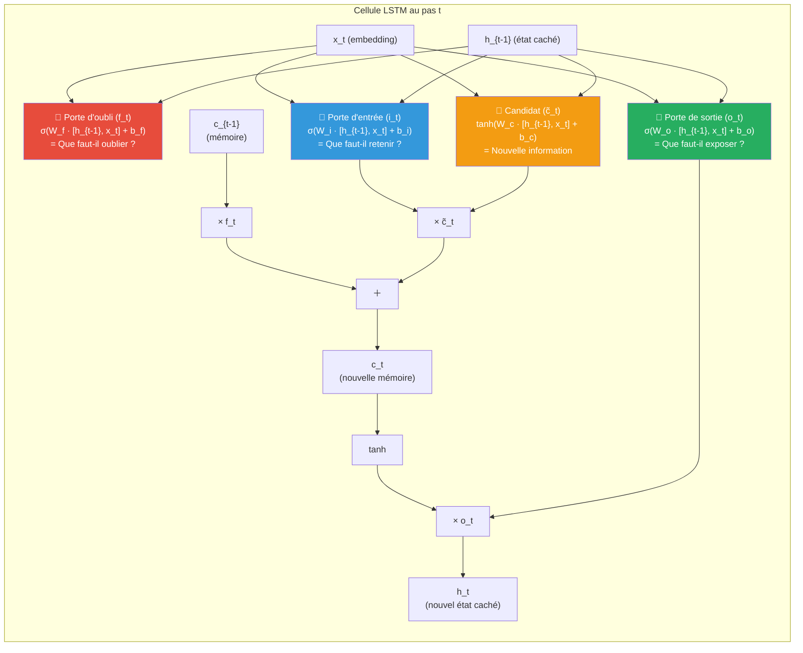
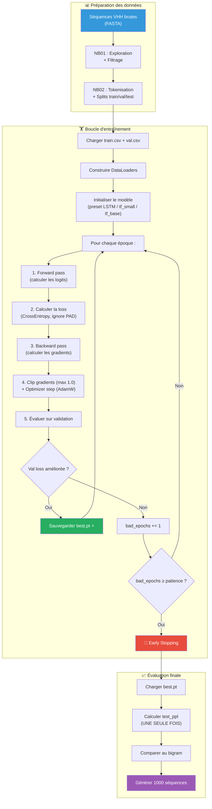

# 📖 Guide Complet — Modèles de Langage pour Séquences Protéiques

> **Projet** : Recherche_AI — Génération de séquences VHH (anticorps à domaine unique)
> **Équipe B** : Modèles & Infrastructure

---

## Table des Matières

1. [Contexte du Projet](#1-contexte-du-projet)
2. [Les Modèles Utilisés](#2-les-modèles-utilisés)
   - [LSTM (Long Short-Term Memory)](#21-lstm-long-short-term-memory)
   - [Causal Transformer (Decoder-Only)](#22-causal-transformer-decoder-only)
   - [Comparaison Structurelle](#23-comparaison-structurelle)
3. [Tokenisation et Vocabulaire](#3-tokenisation-et-vocabulaire)
4. [Métriques à Suivre](#4-métriques-à-suivre)
5. [Comment Savoir si le Modèle est Bon ?](#5-comment-savoir-si-le-modèle-est-bon-)
6. [Architecture Détaillée — Comment Chaque Modèle Fonctionne](#6-architecture-détaillée--comment-chaque-modèle-fonctionne)
7. [Pipeline d'Entraînement](#7-pipeline-dentraînement)
8. [Stratégies d'Échantillonnage (Génération)](#8-stratégies-déchantillonnage-génération)
9. [Diagnostic des Problèmes](#9-diagnostic-des-problèmes)
10. [Comment Améliorer les Modèles](#10-comment-améliorer-les-modèles)
11. [Glossaire](#11-glossaire)

---

## 1. Contexte du Projet

L'objectif est de **générer de nouvelles séquences de protéines VHH** (anticorps à domaine unique de camélidés) qui ressemblent aux séquences naturelles. Pour cela, on entraîne un **modèle de langage autorégressif** : le modèle apprend à prédire le prochain acide aminé étant donné les précédents.

```
Entrée :   <BOS> E V Q L V E S G G G ...
Cible  :         E V Q L V E S G G G ... <EOS>
```

Le modèle apprend la **distribution conditionnelle** P(token_t | token_1, ..., token_{t-1}) sur les 20 acides aminés standard + le token de fin `<EOS>`.

---

## 2. Les Modèles Utilisés

### 2.1 LSTM (Long Short-Term Memory)

#### Qu'est-ce qu'un LSTM ?

Un LSTM est un type de **réseau de neurones récurrent (RNN)** conçu pour capturer les dépendances à long terme dans des séquences. Contrairement à un RNN simple qui souffre du problème de **gradient qui s'évanouit** (vanishing gradient), le LSTM utilise un mécanisme de **portes** (gates) pour contrôler le flux d'information.

#### Architecture de notre LSTM (`LSTMLM`)

```mermaid
graph LR
    A["Token x_t<br/>(id entier)"] --> B["Embedding<br/>V=23 → d=128"]
    B --> C["LSTM Cell<br/>h=256, 1 couche"]
    C --> D["Projection<br/>256 → 128"]
    D --> E["Tête de sortie<br/>128 → V=23"]
    E --> F["Logits<br/>(scores bruts)"]
    F --> G["Softmax → P(x_{t+1})"]

    style A fill:#4a90d9,stroke:#2c5f8a,color:#fff
    style B fill:#7b68ee,stroke:#5a4fcf,color:#fff
    style C fill:#e74c3c,stroke:#c0392b,color:#fff
    style D fill:#f39c12,stroke:#d68910,color:#fff
    style E fill:#7b68ee,stroke:#5a4fcf,color:#fff
    style F fill:#27ae60,stroke:#1e8449,color:#fff
    style G fill:#2ecc71,stroke:#27ae60,color:#fff
```



**Composants clés :**

| Composant | Rôle | Dimensions |
|---|---|---|
| `nn.Embedding` | Convertit chaque token (entier 0–22) en un vecteur dense | 23 → 128 |
| `nn.LSTM` | Traite la séquence récursivement, maintient un état caché | 128 → 256 |
| `nn.Linear` (proj) | Projette l'état caché vers la dimension d'embedding | 256 → 128 |
| `nn.Linear` (head) | Calcule un score (logit) pour chaque token du vocabulaire | 128 → 23 |

**Weight Tying** : La matrice de la tête de sortie (`head.weight`) est **partagée** avec la matrice d'embedding (`embed.weight`). Cela réduit le nombre de paramètres et force le modèle à utiliser un espace de représentation cohérent pour l'entrée et la sortie.

**Initialisation** : `std = 0.1` (distribution normale) pour éviter que les logits initiaux ne soient trop grands.

#### Comment le LSTM traite une séquence



Le LSTM lit la séquence **de gauche à droite**, un token à la fois. À chaque pas, il met à jour son **état caché** `h_t` qui résume toute l'histoire vue jusqu'ici. C'est un **goulot d'étranglement** : toute l'information passée est compressée dans un seul vecteur de 256 dimensions.

#### Paramètres : **431 104** (~431K)

---

### 2.2 Causal Transformer (Decoder-Only)

#### Qu'est-ce qu'un Transformer Causal ?

Un Transformer causal est un modèle basé sur le mécanisme d'**attention** (Vaswani et al. 2017). Contrairement au LSTM qui lit séquentiellement, le Transformer peut regarder **tous les tokens précédents en parallèle** grâce à l'auto-attention masquée. Notre architecture suit le style **GPT-2** (decoder-only, Pre-LayerNorm).

#### Architecture de notre Transformer (`CausalTransformerLM`)



**Composants clés :**

| Composant | Rôle | Dimensions |
|---|---|---|
| Token Embedding | Convertit chaque token en vecteur dense | 23 → 128 |
| Position Embedding | Encode la position (0 à 199) de chaque token | 200 → 128 |
| Multi-Head Attention | Permet à chaque position de « regarder » les positions précédentes | 4 têtes × 32 dim |
| Feed-Forward Network | Transformation non-linéaire (GELU) pour enrichir les représentations | 128 → 512 → 128 |
| LayerNorm | Stabilise les activations (appliquée **avant** l'attention = Pre-LN) | — |
| Tête de sortie | Calcule les logits pour chaque token du vocabulaire | 128 → 23 |

**Weight Tying** : Comme pour le LSTM, `head.weight = token_embed.weight`.

**Initialisation GPT-2** : `std = 0.02` — cruciale pour obtenir une loss initiale correcte (~3.14 nats au lieu de ~47 nats avec `std = 1.0`).

#### Le masque causal : pourquoi et comment

```
Position →    0     1     2     3     4
           ┌─────┬─────┬─────┬─────┬─────┐
Pos 0      │  ✓  │  ✗  │  ✗  │  ✗  │  ✗  │  ← ne voit que soi-même
Pos 1      │  ✓  │  ✓  │  ✗  │  ✗  │  ✗  │  ← voit 0 et 1
Pos 2      │  ✓  │  ✓  │  ✓  │  ✗  │  ✗  │  ← voit 0, 1, 2
Pos 3      │  ✓  │  ✓  │  ✓  │  ✓  │  ✗  │  ← voit 0, 1, 2, 3
Pos 4      │  ✓  │  ✓  │  ✓  │  ✓  │  ✓  │  ← voit tout
           └─────┴─────┴─────┴─────┴─────┘
             ✓ = attention autorisée    ✗ = masqué (-inf)
```

Le masque **triangulaire inférieur** empêche chaque position de « tricher » en regardant les tokens futurs. Sans lui, le modèle pourrait simplement copier la réponse au lieu de la prédire.

#### Presets disponibles

| Preset | `embed_dim` | Têtes | Couches | FFN | Dropout | Paramètres |
|---|---|---|---|---|---|---|
| `tf_small` | 128 | 4 | 4 | 512 | 0.1 | **821 888** (~822K) |
| `tf_base` | 256 | 8 | 6 | 1024 | 0.1 | **4 796 160** (~4.8M) |

---

### 2.3 Comparaison Structurelle



| Critère | LSTM | Transformer Causal |
|---|---|---|
| **Traitement** | Séquentiel (token par token) | Parallèle (toute la séquence) |
| **Mémoire du contexte** | Compressée dans un vecteur fixe (h_t) | Accès direct à chaque token passé via attention |
| **Vitesse d'entraînement** | Plus lent (séquentiel) | Plus rapide (parallélisable sur GPU) |
| **Vitesse de génération** | Rapide (un seul pas de calcul par token) | Plus lent (recalcule l'attention à chaque token) |
| **Dépendances longues** | Difficiles à capturer | Naturellement captées par l'attention |
| **Nombre de paramètres** | ~431K | 822K – 4.8M |
| **Complexité** | O(L) par token | O(L²) pour l'attention |
| **Risque de surapprentissage** | Plus faible (peu de paramètres) | Plus élevé (dropout nécessaire) |

---

## 3. Tokenisation et Vocabulaire

Notre vocabulaire est exactement **V = 23** tokens :

```
┌──────────────────────────────────────────────────────────┐
│ IDs 0–19 : Les 20 acides aminés standards               │
│   A C D E F G H I K L M N P Q R S T V W Y               │
│                                                          │
│ ID 20 : <PAD>  — Remplissage (séquences de tailles       │
│                   différentes dans un batch)              │
│ ID 21 : <BOS>  — Début de séquence (Begin Of Sequence)   │
│ ID 22 : <EOS>  — Fin de séquence (End Of Sequence)       │
└──────────────────────────────────────────────────────────┘
```

**Exemple de tokenisation :**

```
Séquence brute :  "EVQLV"
Encodée        :  [21, 3, 18, 10, 7, 18]
                   BOS  E   V   Q   L   V
Avec EOS       :  [21, 3, 18, 10, 7, 18, 22]
                   BOS  E   V   Q   L   V  EOS
```

**Décalage (shift) pour l'entraînement :**

```
Batch original :  [BOS, E, V, Q, L, V, EOS, PAD, PAD]
Inputs (x)     :  [BOS, E, V, Q, L, V, EOS, PAD]      ← tout sauf le dernier
Targets (y)    :  [E,   V, Q, L, V, EOS, PAD, PAD]     ← tout sauf le premier
                   ↑    ↑  ↑  ↑  ↑   ↑    ↑    ↑
                   Le modèle doit prédire chacun de ces tokens
                   PAD est ignoré dans la loss (ignore_index=20)
```

---

## 4. Métriques à Suivre

### 4.1 Loss en Nats (NLL / token)

La métrique **principale** d'entraînement. Elle mesure la **surprise moyenne** du modèle face à chaque token.

```
                    Σ -log P(token_t | contexte)
nats/token  =  ─────────────────────────────────────
                  nombre de tokens réels (hors PAD)
```

- Unité : **nats** (logarithme naturel, base e). Pour convertir en bits : `bits = nats / ln(2)`.
- **Plus c'est bas, mieux c'est** : le modèle est moins surpris.
- `<BOS>` n'est jamais prédit (c'est toujours le premier), `<EOS>` est compté (le modèle doit apprendre à terminer), `<PAD>` est ignoré.

### 4.2 Perplexité (PPL)

```
PPL = exp(nats/token)
```

Interprétation intuitive : la perplexité est le **nombre effectif de choix** que le modèle hésite entre à chaque position.

| PPL | Signification |
|---|---|
| **1.0** | Le modèle prédit parfaitement chaque token (impossible en pratique) |
| **5.0** | Le modèle hésite entre 5 options à chaque position (très bon) |
| **11.83** | Notre baseline bigram sur les données VHH réelles |
| **20.0** | Modèle complètement aléatoire uniforme (car V_AA = 20 acides aminés) |
| **> 20** | Pire que le hasard (bug probable) |

### 4.3 Taux d'apprentissage (LR)

Suivi du scheduler warmup + cosinus :

```
LR
 ↑
 │          ╭──────────╮
 │         ╱            ╲
 │        ╱              ╲
 │       ╱                ╲  Décroissance cosinus
 │      ╱                  ╲
 │     ╱                    ╲
 │    ╱                      ╲───── min_lr (10% du max)
 │   ╱ Warmup
 │  ╱  linéaire
 │ ╱
 └──────────────────────────────→ Steps
 0    100              total_steps
```

- **Warmup** (100 premiers pas) : le LR monte linéairement de 0 au LR max. Pourquoi ? Les gradients d'un Transformer non entraîné sont instables ; un grand LR initial ferait diverger les poids.
- **Cosinus** (le reste) : le LR décroît en douceur vers 10% du max. Un LR qui baisse lentement permet de converger vers un meilleur minimum.

### 4.4 Tableau Récapitulatif des Métriques

| Métrique | Fichier de sortie | Quand la regarder | Seuil d'alarme |
|---|---|---|---|
| `train_nats` | `history.csv` | À chaque époque | Doit descendre régulièrement |
| `val_nats` | `history.csv` | À chaque époque | Doit suivre train_nats (sinon : overfitting) |
| `val_ppl` | `history.csv` | Sélection du modèle | Doit être **< 11.83** (bigram) |
| `test_ppl` | `test_metrics.json` | **1 seule fois**, à la fin | Métrique finale de publication |
| `lr` | `history.csv` | Diagnostic | Doit suivre le profil warmup-cosinus |
| `n_params` | `metrics.json` | Comparaison des modèles | Plus gros ≠ forcément meilleur |

---

## 5. Comment Savoir si le Modèle est Bon ?

### 5.1 Les 3 Tests de Bon Sens (Sanity Checks)

**Avant tout long entraînement**, ces 3 vérifications doivent passer. Elles sont automatisées dans `tests/test_training.py` :

#### Test (a) : Loss initiale ≈ ln(23) ≈ 3.14 nats



Un modèle non entraîné avec une bonne initialisation devrait prédire chaque token de façon quasi-uniforme. La loss théorique est ln(23) ≈ 3.14. Si la loss initiale est **~47**, l'initialisation est mauvaise (std trop grande). Si elle est **~0**, le modèle voit les réponses (bug de shift/masque).

#### Test (b) : Surapprendre 1 batch

```
8 séquences × 300 pas d'optimisation → loss < 0.3
```

Si le modèle ne peut même pas **mémoriser** 8 séquences, il y a un bug fondamental (backward cassé, loss mal calculée, optimiseur mal configuré).

#### Test (c) : Motif appris et régénéré

```
200 séquences commençant par "EVQLVESGGG" + queue aléatoire
→ Après 40 époques, la génération greedy doit retrouver "EVQLVESGGG"
```

Si le modèle a appris le motif mais ne le génère pas, le masque causal ou les positions sont cassés.

### 5.2 Échelle de Qualité

```
PPL 20.0 ─── Aléatoire uniforme (aucune connaissance)
   │
   │         ↑ Pire
   │
PPL 11.83 ── Baseline Bigram (ne regarde que le token précédent)
   │
   │         ← Objectif minimum : battre cette ligne
   │
PPL 8–10 ─── LSTM bien entraîné (dépendances courtes)
   │
PPL 5–7 ──── Transformer bien entraîné (dépendances longues)
   │
   │         ↓ Meilleur
   │
PPL 2–3 ──── Suspicion de fuite / mémorisation (à investiguer)
   │
PPL 1.0 ──── Perfection (irréaliste)
```

### 5.3 Courbes d'Entraînement — Ce Qu'il Faut Regarder

#### ✅ Entraînement sain

```
Loss
 ↑
 │ ╲
 │  ╲   train ─────
 │   ╲ ╱
 │    ╳
 │   ╱ ╲   val ──────
 │  ╱   ╲─────────────────
 │ ╱
 └──────────────────────────→ Époques
```

Les deux courbes descendent ensemble et convergent. La val peut être légèrement au-dessus du train.

#### ⚠️ Surapprentissage (Overfitting)

```
Loss
 ↑
 │ ╲
 │  ╲         val ────────╱──── ← remonte !
 │   ╲       ╱
 │    ╲─────╱
 │     ╲
 │      ╲   train ──────────── ← continue de baisser
 │       ╲──────────────────
 └──────────────────────────→ Époques
```

Le train descend mais la val remonte : le modèle mémorise les données au lieu de généraliser. **Solutions** : augmenter le dropout, réduire le modèle, ajouter du weight decay.

#### ⚠️ Sous-apprentissage (Underfitting)

```
Loss
 ↑
 │ ─────────────────── train
 │
 │ ─────────────────── val
 │
 │
 └──────────────────────────→ Époques
```

Les deux courbes stagnent à un niveau élevé. **Solutions** : modèle plus grand, plus d'époques, LR plus élevé, vérifier les données.

---

## 6. Architecture Détaillée — Comment Chaque Modèle Fonctionne

### 6.1 Le LSTM en profondeur

#### Les 4 portes du LSTM



| Porte | Rôle | Analogie |
|---|---|---|
| **Oubli** (f_t) | Décide quelle partie de la mémoire ancienne effacer | Effacer le tableau |
| **Entrée** (i_t) | Décide quelles nouvelles informations stocker | Écrire au tableau |
| **Candidat** (c̃_t) | Propose de nouvelles informations | Le contenu à écrire |
| **Sortie** (o_t) | Décide quelle partie de la mémoire exposer comme sortie | Lire le tableau |

### 6.2 Le Transformer en profondeur

#### Multi-Head Self-Attention

L'attention est le cœur du Transformer. Pour chaque position t, elle calcule **à quels tokens précédents il faut faire attention** :

```
                    Q · K^T
Attention(Q,K,V) = softmax(──────) · V
                      √d_k

Q = requête (query)  : "Que cherche-je ?"
K = clé (key)        : "Qu'est-ce que j'offre ?"
V = valeur (value)   : "Quelle information j'apporte ?"
```

**Multi-Head** : on découpe l'attention en 4 « têtes » indépendantes (chacune de dimension 32), permettant au modèle de capturer différents types de relations simultanément :

```
Tête 1 : relations de voisinage (positions proches)
Tête 2 : relations de structure (ponts disulfures, etc.)
Tête 3 : composition en acides aminés
Tête 4 : motifs conservés (CDR, framework)
```

#### Connexions Résiduelles et Pre-LayerNorm

```
Input ──────────────────────┐
  │                         │
  ▼                         │ (connexion résiduelle)
LayerNorm                   │
  │                         │
  ▼                         │
Multi-Head Attention        │
  │                         │
  ▼                         │
  + ◀───────────────────────┘
  │
  ├──────────────────────┐
  ▼                      │ (connexion résiduelle)
LayerNorm                │
  │                      │
  ▼                      │
Feed-Forward (GELU)      │
  │                      │
  ▼                      │
  + ◀────────────────────┘
  │
  ▼
Output
```

- **Connexion résiduelle** (`+ résidu`) : permet au gradient de « court-circuiter » les couches profondes, facilitant l'entraînement.
- **Pre-LayerNorm** (Xiong et al. 2020) : normalise **avant** l'attention/FFN, plus stable que Post-LN pour l'entraînement.
- **GELU** : activation plus douce que ReLU, utilisée dans GPT-2 et BERT.

---

## 7. Pipeline d'Entraînement



### Hyperparamètres clés

| Hyperparamètre | Valeur par défaut | Rôle |
|---|---|---|
| **Optimiseur** | AdamW | Adam avec weight decay découplé (régularisation) |
| **LR** | 6e-4 (Transformer) / 1e-3 (LSTM) | Vitesse d'apprentissage |
| **Weight Decay** | 0.01 | Pénalise les poids trop grands (régularisation L2) |
| **Warmup** | 100 pas | Monte le LR progressivement au début |
| **Grad Clip** | 1.0 | Borne la norme des gradients (empêche l'explosion) |
| **Patience** | 3 époques | Arrête si la val ne s'améliore pas pendant 3 époques |
| **AMP** | Oui (GPU) | Précision mixte float16 pour accélérer l'entraînement |
| **Batch Size** | 128 | Nombre de séquences par mini-batch |

---

## 8. Stratégies d'Échantillonnage (Génération)

Après l'entraînement, on génère de nouvelles séquences en prédisant un token à la fois de façon autorégressive :


### 4 Méthodes de Sélection du Prochain Token

| Méthode | Comment ça marche | Diversité | Qualité |
|---|---|---|---|
| **Greedy** (argmax) | Toujours le token le plus probable | ❌ Aucune | ✅ Optimale localement |
| **Température** (T) | Divise les logits par T avant softmax | ↕ Contrôlable | ↕ Variable |
| **Top-K** | Garde les K tokens les plus probables, zéro le reste | ⬆ Modérée | ⬆ Bonne |
| **Nucleus (Top-P)** | Garde le plus petit ensemble dont la masse cumulée ≥ P | ⬆ Adaptative | ⬆ Très bonne |

#### Effet de la température

```
T = 0.3 (basse)              T = 1.0 (neutre)            T = 2.0 (haute)
┌────────────────┐           ┌────────────────┐          ┌────────────────┐
│ ████████████   │  E: 70%   │ ████████       │  E: 40%  │ █████          │  E: 22%
│ ███            │  V: 15%   │ █████          │  V: 25%  │ ████           │  V: 18%
│ ██             │  Q: 10%   │ ███            │  Q: 15%  │ ████           │  Q: 16%
│ █              │  ...       │ ██             │  ...      │ ███            │  ...
│                │            │ █              │           │ ███            │
└────────────────┘           └────────────────┘          └────────────────┘
 Très confiant                Naturel                     Très aléatoire
 Répétitif                    Équilibré                   Incohérent
```

#### Top-K en action (K=3)

```
Distribution originale :       Après Top-K (K=3) :
E: 0.35  ████████████          E: 0.47  ████████████████
V: 0.25  ████████              V: 0.33  ██████████████
Q: 0.15  ████                  Q: 0.20  ████████
L: 0.10  ██                    L: 0.00  (éliminé)
A: 0.08  █                     A: 0.00  (éliminé)
...                             ...
```

#### Nucleus (Top-P) en action (P=0.9)

```
Trié par probabilité :         Masse cumulée :      Gardé ?
E: 0.35                        0.35                 ✅ (< 0.9)
V: 0.25                        0.60                 ✅ (< 0.9)
Q: 0.15                        0.75                 ✅ (< 0.9)
L: 0.10                        0.85                 ✅ (< 0.9)
A: 0.08                        0.93                 ✅ (masse avant = 0.85 < 0.9)
S: 0.04                        0.97                 ❌ (masse avant = 0.93 ≥ 0.9)
G: 0.03                        1.00                 ❌
```

### Sécurités implémentées

1. **PAD et BOS ne sont jamais tirés** : leurs logits sont mis à `-inf` avant le softmax.
2. **Température > 0 stricte** : pas d'epsilon flottant ; le mode greedy est un `argmax` explicite.
3. **Graine par batch** : `seed + b` assure la reproductibilité et l'indépendance entre batchs.
4. **Suivi de terminaison** : on sait si chaque séquence a produit un `<EOS>` ou a atteint `max_len`.

---

## 9. Diagnostic des Problèmes

### Tableau de Diagnostic Rapide

| Symptôme | Cause probable | Solution |
|---|---|---|
| Loss initiale ≈ **47 nats** | `std` d'init trop grand (1.0 au lieu de 0.02) | Appliquer l'init GPT-2 (S2.1) |
| Loss initiale ≈ **0** | Le modèle voit les réponses (bug de shift/masque) | Vérifier `shift()` et le masque causal |
| Train ↓ mais Val ↑ | Surapprentissage | `--dropout 0.2`, modèle plus petit, early stopping |
| Train et Val stagnent haut | Sous-apprentissage | Modèle plus grand, plus d'époques, LR plus haut |
| Loss en dents de scie | LR trop élevé | Réduire `--lr` (ex: 3e-4) |
| Loss = **NaN** | Explosion des gradients ou bug AMP | `--no-amp`, réduire `--lr`, vérifier grad_clip |
| Val PPL > 11.83 (bigram) | Le modèle neuronal ne bat pas la baseline | Refaire les sanity checks ; vérifier les données |
| Val PPL ≈ 2–3 | Suspicion de mémorisation | Vérifier les quasi-doublons entre train et test |
| Séquences générées très courtes | PAD tiré en milieu de séquence | Vérifier que PAD est bien masqué dans `sampling.py` |
| Toutes les séquences identiques | Mode greedy ou température trop basse | Augmenter T, utiliser top-k ou nucleus |

### Vérifier la qualité des séquences générées

```
✅ Bonnes séquences :
  EVQLVESGGGLVQPGGSLRLSCAASGFTFSSYAMSWVRQAPG...  (longueur ~120, commence par EVQLV)

⚠️ Séquences suspectes :
  AAAAAAAAAAAAA...  (répétition → mode collapse, T trop basse)
  XMZB...           (caractères invalides → bug de décodage)
  EV                (trop courte → EOS trop tôt, modèle mal entraîné)
```

---

## 10. Comment Améliorer les Modèles

### 10.1 Améliorations d'Architecture

| Amélioration | Difficulté | Impact attendu | Description |
|---|---|---|---|
| **Augmenter `embed_dim`** | 🟢 Facile | Moyen | Passer de 128 à 256 (déjà dans `tf_base`) |
| **Plus de couches** | 🟢 Facile | Moyen | 6 → 8 couches (attention au surapprentissage) |
| **Rotary Position Embeddings (RoPE)** | 🟡 Moyen | Bon | Meilleure généralisation sur les positions (utilisé dans LLaMA) |
| **LSTM bidirectionnel** | 🟡 Moyen | Bon pour compréhension | Ne fonctionne PAS pour la génération autorégressive |
| **GRU au lieu de LSTM** | 🟢 Facile | Variable | Plus rapide, parfois aussi bon |
| **Flash Attention** | 🟡 Moyen | Vitesse ×2–3 | Accélère l'attention sans changer la qualité |

### 10.2 Améliorations d'Entraînement

| Amélioration | Difficulté | Impact attendu | Description |
|---|---|---|---|
| **Label Smoothing** | 🟢 Facile | Bon | `CrossEntropyLoss(label_smoothing=0.1)` — évite la surconfiance |
| **Dropout + DropPath** | 🟢 Facile | Bon | Régularisation stochastique des couches |
| **Data Augmentation** | 🟡 Moyen | Très bon | Reverse complement, masquage aléatoire de positions |
| **Gradient Accumulation** | 🟢 Facile | Moyen | Simule un batch plus grand sur GPU limité |
| **Stochastic Weight Averaging** | 🟡 Moyen | Bon | Moyenne des poids des dernières époques |
| **Learning Rate Finder** | 🟡 Moyen | Bon | Trouver le LR optimal automatiquement |

### 10.3 Améliorations des Données

| Amélioration | Difficulté | Impact attendu | Description |
|---|---|---|---|
| **Plus de données** | 🟢 Facile | Très bon | Fusionner plusieurs jeux SRR |
| **Filtrage de qualité** | 🟢 Facile | Bon | Retirer les séquences avec des régions de basse complexité |
| **Déduplication stricte** | 🟢 Facile | Bon | Retirer les séquences identiques ou quasi-identiques |
| **Pondération par fréquence** | 🟡 Moyen | Moyen | Sous-échantillonner les séquences sur-représentées |

### 10.4 Évaluation Avancée (Sprint 3+)

| Métrique | But | Implémentation |
|---|---|---|
| **Composition en AA** | Les séquences générées ont-elles la même distribution d'acides aminés ? | `compute_aa_composition()` dans `utils.py` |
| **Distribution de longueur** | La longueur des séquences générées est-elle réaliste ? | Histogramme des longueurs |
| **Diversité** | Les séquences sont-elles variées ou répétitives ? | Nombre de séquences uniques / total |
| **Motifs conservés** | Les régions framework sont-elles préservées ? | Recherche de motifs connus (CDR1, CDR2, CDR3) |
| **Score de naturalité** | Les séquences ressemblent-elles à des vraies protéines ? | Alignment BLAST contre une base de données |

---

## 11. Glossaire

| Terme | Définition |
|---|---|
| **Autorégressif** | Le modèle génère un token à la fois, conditionnellement aux tokens précédents |
| **Batch** | Un groupe de séquences traitées ensemble pour paralléliser le calcul |
| **BOS / EOS / PAD** | Tokens spéciaux : Begin/End Of Sequence, Padding (remplissage) |
| **Causal** | Le modèle ne peut pas « regarder dans le futur » (masque triangulaire) |
| **Checkpoint** | Sauvegarde des poids du modèle (best.pt = meilleur sur validation, last.pt = dernier) |
| **Cross-Entropy** | Fonction de perte mesurant la différence entre la distribution prédite et la cible |
| **Decoder-Only** | Architecture Transformer sans encodeur, utilisée pour la génération (GPT) |
| **Dropout** | Désactive aléatoirement des neurones pendant l'entraînement (régularisation) |
| **Early Stopping** | Arrête l'entraînement quand la validation ne s'améliore plus |
| **Embedding** | Représentation dense d'un token discret dans un espace vectoriel continu |
| **GELU** | Gaussian Error Linear Unit — activation non-linéaire (plus douce que ReLU) |
| **Gradient Clipping** | Borne la norme des gradients pour éviter l'explosion |
| **LayerNorm** | Normalise les activations à moyenne 0 et variance 1 dans chaque couche |
| **Logits** | Scores bruts en sortie du modèle, avant softmax |
| **Nats** | Unité de mesure de l'information (logarithme naturel, base e) |
| **NLL** | Negative Log-Likelihood — la perte mesure la vraisemblance inverse |
| **Perplexité** | exp(nats/token) — nombre effectif de choix hésitants par position |
| **Pre-LN** | LayerNorm appliquée avant l'attention (plus stable que Post-LN) |
| **Softmax** | Transforme des logits en probabilités (somme = 1) |
| **VHH** | Variable domain of Heavy chain of Heavy-chain antibody — anticorps de camélidés |
| **Warmup** | Phase initiale où le LR augmente progressivement |
| **Weight Decay** | Régularisation L2 décorrélée appliquée aux poids (pas aux biais) |
| **Weight Tying** | Partage des poids entre l'embedding d'entrée et la tête de sortie |

---

> **Fichiers de référence dans le repo :**
> - Architectures des modèles : `models.py`
> - Boucle d'entraînement : `training.py`
> - Stratégies de génération : `sampling.py`
> - Script CLI d'entraînement : `scripts/train.py`
> - Tests de bon sens : `tests/test_training.py`
> - Tests de sampling : `tests/test_sampling.py`
> - Utilitaires et tokenizer : `utils.py`
