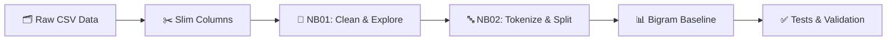
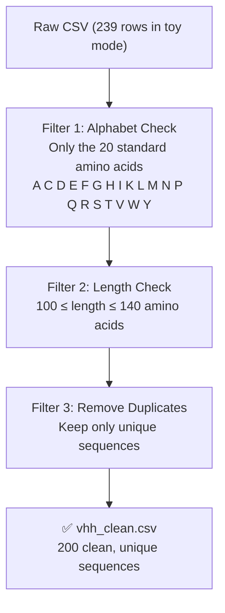
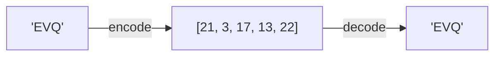
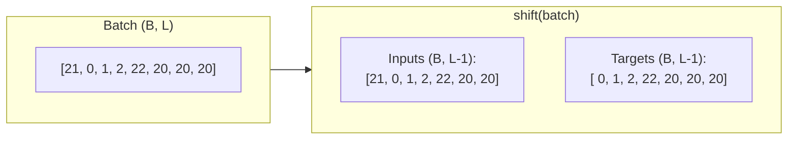
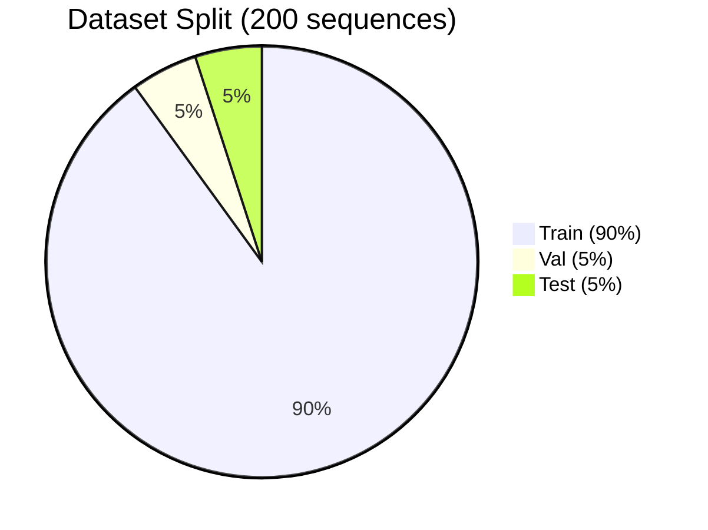
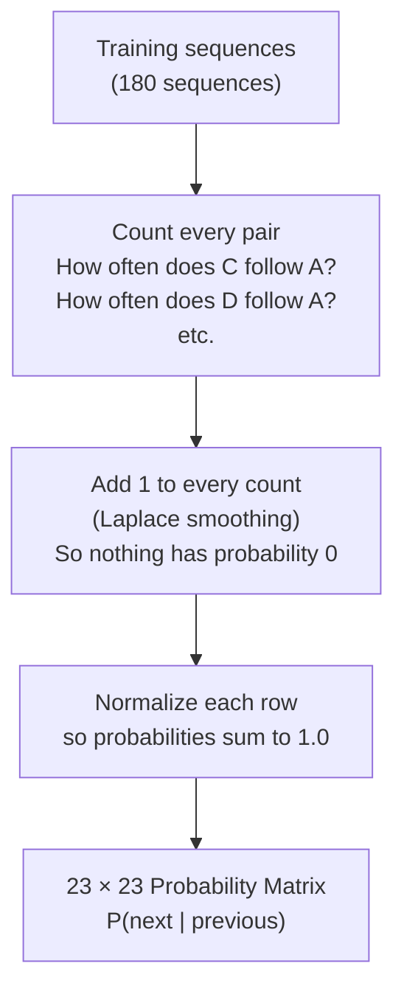
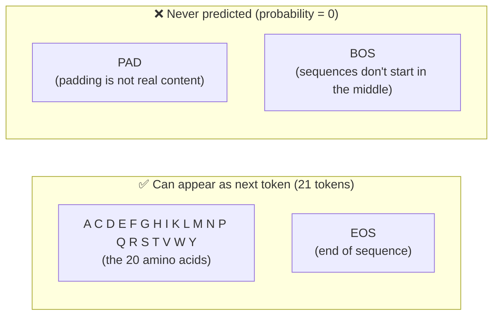
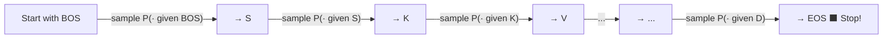
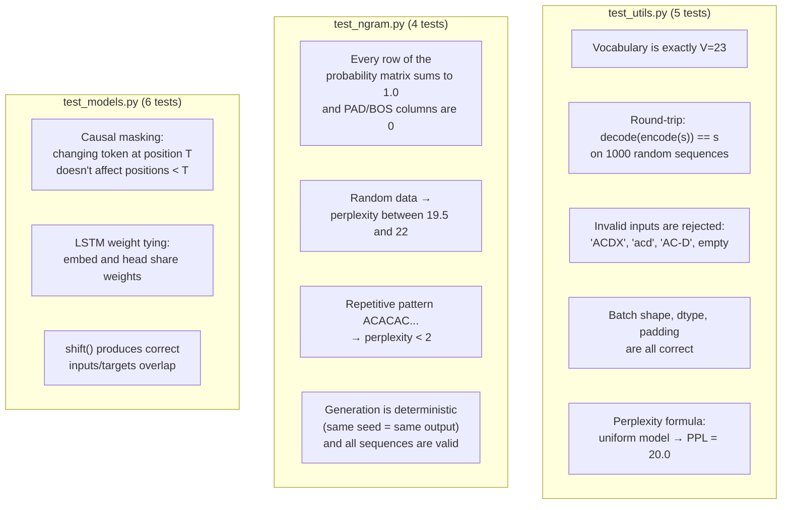
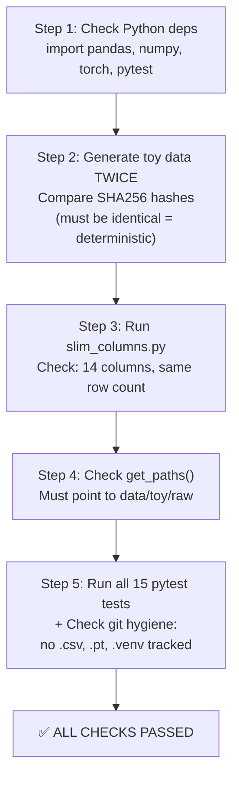

# Sprint 1 — How Everything Works (Step by Step)

This document walks you through the **entire Sprint 1 workflow**, from raw data all the way to the bigram baseline and its tests. Each section explains **what happens**, **why**, and shows **concrete examples** so you can follow along.

---

## The Big Picture

Here is the full pipeline at a glance. Each box is explained in detail below.



> **Two modes:** everything runs in **toy mode** locally (fake data, instant) and in **real mode** on Google Colab (actual VHH nanobody sequences from OAS).

---

## Step 1 — Generate or Obtain Raw Data

Before any notebook runs, we need raw data in CSV format.

**Locally (toy mode):**

```powershell
python scripts/make_toy_data.py
```

This creates `data/toy/raw/toy_oas_raw.csv` — a file with **239 fake protein sequences** and 20 metadata columns. It is fully deterministic: running it twice produces the exact same file (verified by SHA256 hash).

**On Colab (real mode):**

Team A places real OAS `.csv.gz` files in `AI_Project_Shared/data/raw/` on Google Drive.

---

## Step 2 — NB01: Explore & Clean the Data

📓 **Notebook:** `project1/notebooks/NB01_exploration_donnees.ipynb`

NB01 is the **only place where sequences are cleaned**. It takes the raw CSV and applies three strict filters:



### What gets rejected?

| Sequence Example | Reason | Rejected? |
|---|---|---|
| `ACDEFGHIKLMNPQRSTVWY...` (120 aa) | All valid letters, good length | ✅ Kept |
| `ACDE-FGHIK...` | Contains a gap `-` | ❌ Rejected |
| `ACDEXfghik...` | Contains `X` (ambiguous) and lowercase | ❌ Rejected |
| `ACDE` (4 aa) | Too short (< 100) | ❌ Rejected |
| `ACDE...` (200 aa) | Too long (> 140) | ❌ Rejected |
| Same as another sequence | Duplicate | ❌ Removed |

### What NB01 produces

| Output File | What's Inside |
|---|---|
| `data/processed/toy/vhh_clean.csv` | One column: `sequence`. Each row is a clean, unique protein sequence. |
| `data/processed/toy/manifest.json` | Metadata: how many sequences, length stats, amino acid frequencies, creation date, git commit. |

> [!NOTE]
> Before running NB01 locally, you need to slim the raw file first:
> ```powershell
> python scripts/slim_columns.py --inputs data/toy/raw/toy_oas_raw.csv --out-dir data/toy/processed/slim
> ```
> This keeps only the 14 useful columns out of the original 20. NB01 reads from this slimmed file.

---

## Step 3 — NB02: Tokenization & Train/Val/Test Splits

📓 **Notebook:** `project1/notebooks/NB02_tokenization_datasets_splits.ipynb`

NB02 does two things:
1. Validates that the tokenizer works correctly on the cleaned sequences.
2. Splits the data into **train / val / test** sets.

### How the Tokenizer Works

The tokenizer lives in `utils.py` → class `AminoAcidTokenizer`. It converts amino acid letters into numbers that a model can process.

**The vocabulary has exactly 23 tokens:**

| ID | Token | Meaning |
|:---:|:---:|---|
| 0 | `A` | Alanine |
| 1 | `C` | Cysteine |
| 2 | `D` | Aspartic acid |
| 3 | `E` | Glutamic acid |
| 4 | `F` | Phenylalanine |
| 5 | `G` | Glycine |
| 6 | `H` | Histidine |
| 7 | `I` | Isoleucine |
| 8 | `K` | Lysine |
| 9 | `L` | Leucine |
| 10 | `M` | Methionine |
| 11 | `N` | Asparagine |
| 12 | `P` | Proline |
| 13 | `Q` | Glutamine |
| 14 | `R` | Arginine |
| 15 | `S` | Serine |
| 16 | `T` | Threonine |
| 17 | `V` | Valine |
| 18 | `W` | Tryptophan |
| 19 | `Y` | Tyrosine |
| **20** | **`<PAD>`** | **Padding** (fills short sequences in a batch) |
| **21** | **`<BOS>`** | **Beginning of Sequence** (marks the start) |
| **22** | **`<EOS>`** | **End of Sequence** (marks the end) |

> [!IMPORTANT]
> There is **no `<UNK>` token**. If a sequence contains any letter outside the 20 amino acids, the tokenizer raises an error immediately. Invalid data should have been caught by NB01.

### Encoding Example: `"EVQ"`

Let's trace what happens step by step:

```
Input string:   "EVQ"

Step 1 — Look up each letter:
   E → 3
   V → 17
   Q → 13

Step 2 — Add special tokens:
   <BOS> at the start → 21
   <EOS> at the end   → 22

Result:  [21, 3, 17, 13, 22]
          ↑   ↑   ↑   ↑   ↑
        BOS   E   V   Q  EOS
```



The **round-trip** always works: `decode(encode(s)) == s` for any valid sequence. NB02 verifies this on 1000 random sequences + all 200 real ones.

### Decoding Rules

When decoding a list of IDs back to a string:
- **Skip** `<BOS>` (21) and `<PAD>` (20) — they are structural, not content.
- **Stop** at the first `<EOS>` (22) — everything after is padding.
- **Convert** IDs 0–19 back to their amino acid letter.

### How Batching Works (Padding)

Real sequences have different lengths. To process them together in a batch, we **pad shorter ones on the right** with `<PAD>` (20):

```
Sequence 1: "ACD"    → encode → [21,  0,  1,  2, 22]           (length 5)
Sequence 2: "ACDEFG" → encode → [21,  0,  1,  2,  3,  4,  5, 22]  (length 8)

Batched together (padded to length 8):
┌──────┬────┬────┬────┬─────┬─────┬─────┬─────┐
│ BOS  │  A │  C │  D │ EOS │ PAD │ PAD │ PAD │  ← Seq 1 (padded)
├──────┼────┼────┼────┼─────┼─────┼─────┼─────┤
│ BOS  │  A │  C │  D │  E  │  F  │  G  │ EOS │  ← Seq 2
└──────┴────┴────┴────┴─────┴─────┴─────┴─────┘
  21      0    1    2   22    20    20    20
  21      0    1    2    3     4     5    22
```

### How `shift()` Prepares Training Data

To train a language model, we need **input → target** pairs where the target is "the next token." The `shift()` function does this by slicing the batch:

```
Original:  [BOS,  A,  C,  D, EOS, PAD, PAD, PAD]

Inputs  = everything EXCEPT the last:   [BOS,  A,  C,  D, EOS, PAD, PAD]
Targets = everything EXCEPT the first:  [  A,  C,  D, EOS, PAD, PAD, PAD]

The model learns:
  Given BOS → predict A
  Given A   → predict C
  Given C   → predict D
  Given D   → predict EOS
```



### Train / Val / Test Split

NB02 shuffles the 200 clean sequences (with seed=42 for reproducibility) and splits them:



| Split | Size | File | Purpose |
|---|:---:|---|---|
| **Train** | 180 | `train.csv` | Fit the model on these |
| **Validation** | 10 | `val.csv` | Evaluate during development |
| **Test** | 10 | `test.csv` | 🔒 **Locked** — only used for the final evaluation |

The three sets are **completely disjoint** — no sequence appears in more than one split. NB02 checks this automatically.

---

## Step 4 — The Bigram Baseline Model

📄 **Code:** `ngram.py` (class `BigramLM`)
📄 **Runner:** `scripts/run_baseline.py`
📓 **Notebook:** `project1/notebooks/NB02b_baseline_ngram.ipynb` (Colab & Local)

This is a simple statistical model to set a **performance floor**. It answers: "How well can you predict the next amino acid by only looking at the previous one?"

### How It Works (Simple Explanation)

The bigram model counts how often each amino acid follows each other amino acid in the training data, then turns those counts into probabilities.



### Concrete Example

Suppose in our training data, after the letter **A**, we see:
- C appears 50 times
- D appears 30 times
- E appears 20 times
- ... (other amino acids)

After adding smoothing (+1 to each) and normalizing, we get:

```
P(C | A) = 51 / total ≈ 0.08
P(D | A) = 31 / total ≈ 0.05
P(E | A) = 21 / total ≈ 0.03
...
```

### Which Tokens Can Be Predicted?

This is an important design choice:



> [!IMPORTANT]
> Smoothing is applied **only** to the 21 valid next tokens (20 AA + EOS). If we accidentally spread probability to PAD and BOS, we'd waste probability mass on impossible events and get an artificially worse perplexity score.

### How Perplexity Works

**Perplexity** measures "how surprised the model is" when it sees the validation data. Lower = better.

```
For each sequence in val:
  For each position:
    Look up P(actual_next_token | previous_token)
    Add -ln(P) to the total loss

nats/token = total_loss / number_of_tokens
perplexity = exp(nats/token)
```

**How to interpret perplexity:**

| Perplexity | What It Means |
|:---:|---|
| **20.0** | The model is **guessing randomly** among 20 amino acids — it learned nothing. |
| **~20–21** | Expected on **toy data** (random fake sequences have no patterns to learn). |
| **< 20** | The model found **real patterns** — expected on biological VHH data. |
| **< 15** | 🚨 Suspiciously good — might indicate a bug or data leakage. |
| **< 2** | Only possible on highly repetitive data (like `ACACAC...`). |

**Our toy result:**

```
data_version=toy | train=180 | val=10
val: 3.0314 nats/token | perplexity 20.725
```

This confirms the model works correctly: random data → perplexity ≈ 20 (as expected).

### How Sequence Generation Works

The model can also **generate** new sequences by sampling from its probability matrix:



1. Start with `<BOS>`.
2. Sample the next amino acid from `P(next | current)`.
3. Repeat until `<EOS>` is sampled or `max_len` is reached.
4. Decode the IDs back to a string.

Example generated sequences (on toy data):
```
SKVRDYSSDLIWQTKFNCTPSHYWTEKADQSYHILEDLFQKTRHTTIGQDFASQRTLNED
DWFAMITTHYGMGWEAK
WSVWNHSQICSGWGDTEENVEGSYLDAFDQDMQNFTRSDDWKGLQYGWAMPCDKYNWTLS
```

These are nonsensical (as expected — the model was trained on random data).

---

## Step 5 — Tests & Validation

We have **15 unit tests** organized in 3 files. They run with `python -m pytest -q`.

### Test Overview



### What Each Test Checks

| Test | What It Verifies | Why It Matters |
|---|---|---|
| `test_vocab_is_exactly_23` | IDs are 0–19 for AA, 20/21/22 for special | A wrong mapping breaks everything downstream |
| `test_roundtrip_1000_random_sequences` | encode then decode gives back the original | Proves no information is lost |
| `test_invalid_sequences_are_rejected` | `X`, `-`, lowercase, empty → ValueError | Catches bad data before it corrupts training |
| `test_batch_shape_dtype_and_padding` | Tensor is (B, L) int64, padded on the right | Wrong shapes crash the training loop |
| `test_uniform_model_has_perplexity_20` | Math check: ln(20) × 100 tokens → PPL = 20 | Validates the perplexity formula itself |
| `test_rows_sum_to_one_and_no_mass_on_pad_bos` | P sums to 1; P(PAD)=0, P(BOS)=0 | Invalid probabilities = wrong perplexity |
| `test_random_data_perplexity_close_to_20` | PPL in [19.5, 22] on random sequences | A value < 15 means there's a bug or data leak |
| `test_learns_a_pattern` | ACACAC... × 200 → PPL < 2 | Proves the model actually learns from data |
| `test_generate_is_decodable_and_deterministic` | Same seed = same output; all valid AA | Reproducibility + no invalid characters |

### The `verify_workflow.ps1` Script

This script runs a **complete end-to-end check** in one command:

```powershell
powershell -ExecutionPolicy Bypass -File scripts\verify_workflow.ps1
```

What it does, step by step:



### The `check_sample.py` Script

Used later (Thursday/Friday) to validate Team A's 100 real VHH sequences:

```powershell
python scripts/check_sample.py C:\path\to\sample_100_vhh.txt
# Expected output: 100/100 round-trips OK
```

If any sequence fails, it means it contains letters outside the 20 standard amino acids (usually `X` or `-`), and Team A needs to know.

---

## Step 6 — Running Everything (Quick Reference)

```powershell
# 0. Activate the virtual environment
.venv\Scripts\activate

# 1. Generate toy data + slim it
python scripts/make_toy_data.py
python scripts/slim_columns.py --inputs data/toy/raw/toy_oas_raw.csv --out-dir data/toy/processed/slim

# 2. Run NB01 then NB02 (Restart & Run All in the notebook UI)
#    This produces: data/toy/processed/toy/train.csv, val.csv, test.csv

# 3. Run all 15 tests
python -m pytest -q

# 4. Fit the bigram baseline and evaluate on validation data
python scripts/run_baseline.py

# 5. Full automated verification
powershell -ExecutionPolicy Bypass -File scripts\verify_workflow.ps1
#    Expected: "15 passed" + "ALL CHECKS PASSED"

# 6. On Colab with real data
python scripts/run_baseline.py --data-version v1
```

---

## Summary: What Each File Does

| File | Role |
|---|---|
| `scripts/make_toy_data.py` | Generates 239 fake OAS rows (deterministic) |
| `scripts/slim_columns.py` | Reduces CSV to 14 useful columns |
| `NB01_exploration_donnees.ipynb` | Cleans sequences (alphabet + length + dedup) |
| `NB02_tokenization_datasets_splits.ipynb` | Validates tokenizer + creates train/val/test splits |
| `utils.py` | Tokenizer, DataLoader, paths, metrics — shared by everything |
| `models.py` | LSTM and Transformer architectures (used in Sprint 2) |
| `ngram.py` | Bigram language model baseline |
| `scripts/run_baseline.py` | Fits bigram on train, evaluates on val, saves JSON |
| `scripts/check_sample.py` | Validates Team A's 100 real sequences |
| `scripts/verify_workflow.ps1` | Automated end-to-end sanity check |
| `tests/test_utils.py` | 5 tests for tokenizer, batching, metrics |
| `tests/test_ngram.py` | 4 tests for the bigram model |
| `tests/test_models.py` | 6 tests for LSTM/Transformer (Sprint 2 prep) |
