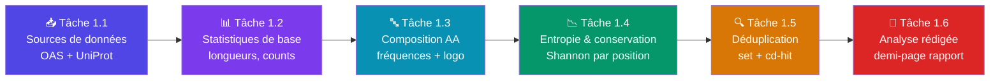
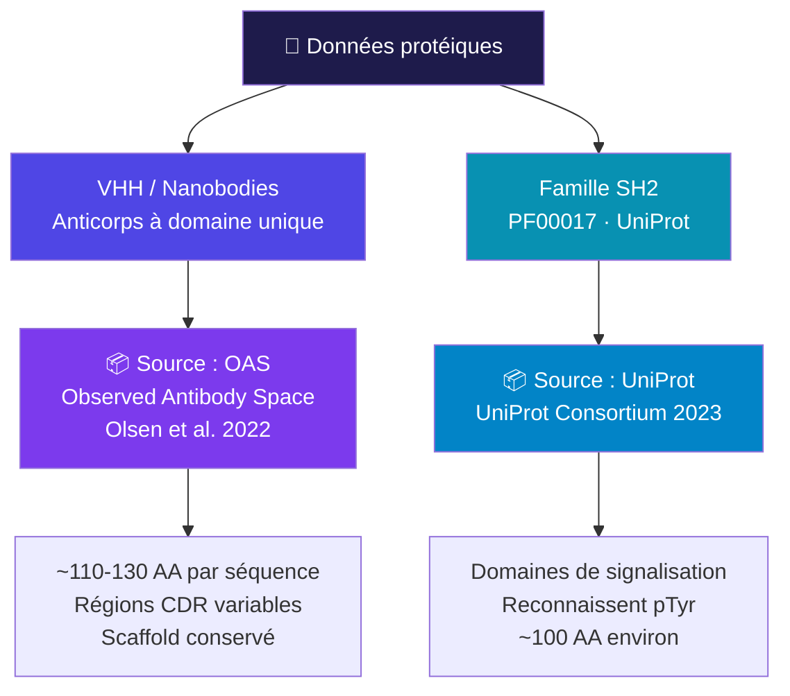
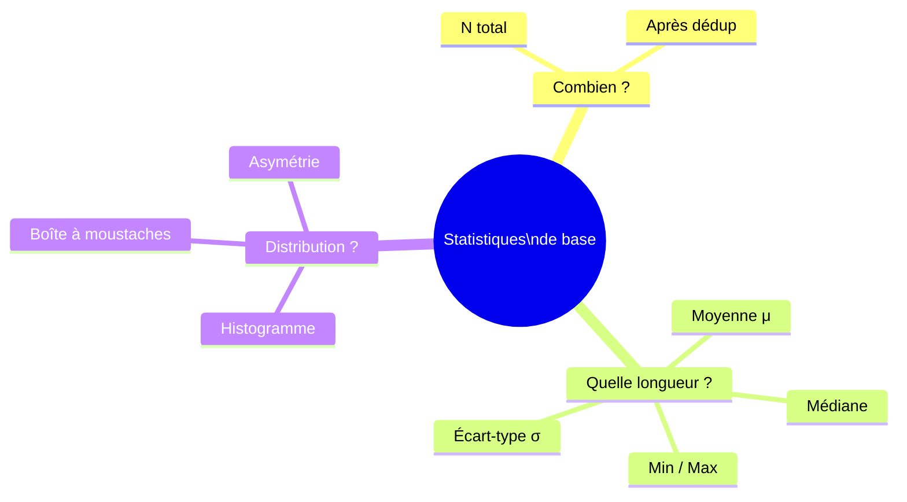
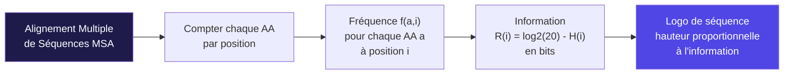
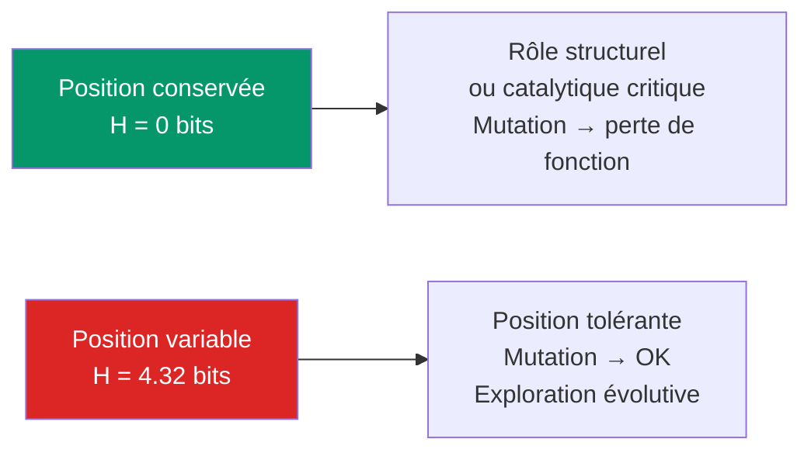
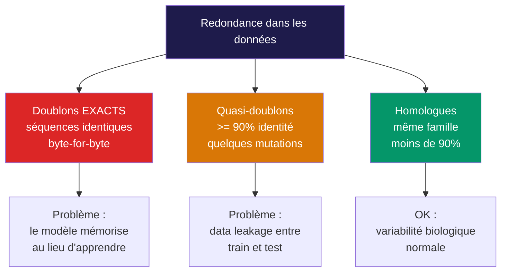
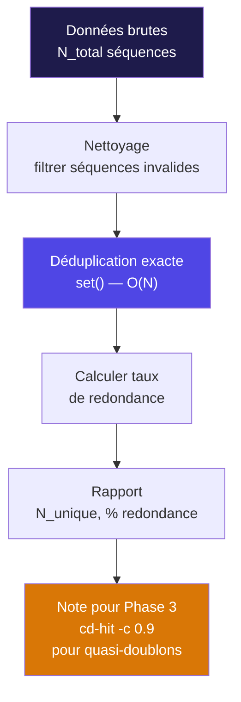
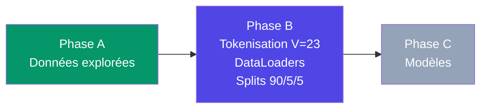

# Phase A — Exploration des Données 🔬
### *Semaine 1 · Notebook : `NB01_exploration_donnees.ipynb`*

---

## 🗺️ Vue d'ensemble de la Phase A



> **Objectif global :** Comprendre profondément les données *avant* de toucher à un modèle.
> Un modèle entraîné sur des données mal comprises est un modèle mal entraîné.

---

## Tâche 1.1 — Sources de Données 📥

### 💡 Explication

On travaille sur **deux familles de séquences protéiques** :



#### Qu'est-ce qu'un VHH ?

```
Anticorps classique (IgG) :       Anticorps camélidé :        VHH isolé (Nanobody) :

    VH — VL                           VHH                          VHH
   /       \                          |                             |
  CH1     CL    <->                   CH2                      [CDR1][CDR2][CDR3]
   |       |                          |                        scaffold conservé
  CH2     ...                        CH3

  ~150 kDa                          ~75 kDa                     ~15 kDa (✅ cible idéale)
```

> **Pourquoi les VHH ?** Taille réduite, solubilité, stabilité → cibles idéales pour la génération computationnelle.

### 🔧 Solution étape par étape

**Étape 1 : Télécharger les VHH depuis OAS**

```python
# NB01 - Cellule 1
import pandas as pd
import requests
from pathlib import Path

ALPHABET = set("ACDEFGHIKLMNPQRSTVWY")

# --- VHH depuis OAS ---
def load_vhh_sequences(filepath: str) -> list:
    """Charge les séquences VHH depuis un fichier CSV OAS."""
    df = pd.read_csv(filepath, skiprows=1)  # ligne 0 = métadonnées OAS
    seqs = df['sequence_alignment_aa'].dropna().tolist()
    # Filtrer : garder uniquement les séquences sur l'alphabet des 20 AA
    seqs = [s for s in seqs if set(s).issubset(ALPHABET) and len(s) > 0]
    return seqs

# --- SH2 depuis UniProt ---
def load_sh2_sequences() -> list:
    """Télécharge les séquences de la famille PF00017 (SH2) depuis UniProt."""
    url = (
        "https://rest.uniprot.org/uniprotkb/stream"
        "?format=fasta&query=family%3A%22SH2+domain%22+AND+reviewed%3Atrue"
    )
    response = requests.get(url, timeout=60)
    response.raise_for_status()

    seqs = []
    current_seq = []
    for line in response.text.splitlines():
        if line.startswith('>'):
            if current_seq:
                seqs.append(''.join(current_seq))
            current_seq = []
        else:
            current_seq.append(line.strip())
    if current_seq:
        seqs.append(''.join(current_seq))
    return seqs

vhh_seqs = load_vhh_sequences("data/vhh_oas.csv")
sh2_seqs  = load_sh2_sequences()

print(f"VHH  : {len(vhh_seqs):,} séquences chargées")
print(f"SH2  : {len(sh2_seqs):,} séquences chargées")
```

### 📚 Ressources

| Ressource | Lien | Description |
|-----------|------|-------------|
| OAS Database | http://opig.stats.ox.ac.uk/webapps/oas | Base de données anticorps observés |
| UniProt REST API | https://rest.uniprot.org | API de téléchargement UniProt |
| Olsen et al. 2022 | *J. Immunology* | Article original OAS |
| UniProt Consortium 2023 | *NAR 51(D1)* | Documentation UniProt |

---

## Tâche 1.2 — Statistiques de Base 📊

### 💡 Explication

Avant tout modèle, il faut répondre à des questions fondamentales :



#### Pourquoi la longueur est-elle critique ?

```
Longueur = L  →  Impact sur :
┌─────────────────────────────────────────────────────────┐
│  Tokenisation  : taille des tenseurs (B × L)            │
│  Padding       : perte de calcul si L très variable      │
│  Architecture  : longueur max du contexte Transformer    │
│  Génération    : quand s'arrêter ? → rôle de <EOS>       │
└─────────────────────────────────────────────────────────┘
```

### 🔧 Solution étape par étape

**Étape 1 : Calculer les statistiques**

```python
# NB01 - Cellule 2
import numpy as np
import matplotlib.pyplot as plt

def compute_stats(sequences: list, label: str):
    """Calcule et affiche les statistiques de longueur."""
    lengths = np.array([len(s) for s in sequences])

    stats = {
        "N"      : len(lengths),
        "min"    : lengths.min(),
        "max"    : lengths.max(),
        "mean"   : lengths.mean(),
        "median" : np.median(lengths),
        "std"    : lengths.std(),
        "q25"    : np.percentile(lengths, 25),
        "q75"    : np.percentile(lengths, 75),
    }

    print(f"\n{'='*45}")
    print(f"  {label}")
    print(f"{'='*45}")
    print(f"  N           : {stats['N']:>10,}")
    print(f"  Min         : {stats['min']:>10}")
    print(f"  Max         : {stats['max']:>10}")
    print(f"  Moyenne     : {stats['mean']:>10.1f}")
    print(f"  Médiane     : {stats['median']:>10.1f}")
    print(f"  Std         : {stats['std']:>10.1f}")
    print(f"  Q25 / Q75   : {stats['q25']:>5.0f} / {stats['q75']:.0f}")

    return stats, lengths

stats_vhh, len_vhh = compute_stats(vhh_seqs, "VHH (Nanobodies)")
stats_sh2, len_sh2  = compute_stats(sh2_seqs,  "SH2 (PF00017)")
```

**Étape 2 : Visualiser les distributions**

```python
fig, axes = plt.subplots(2, 2, figsize=(14, 10))
fig.suptitle("Phase A — Statistiques de longueur", fontsize=16, fontweight='bold')

for ax, lengths, label, color in [
    (axes[0, 0], len_vhh, "VHH", "#4f46e5"),
    (axes[0, 1], len_sh2, "SH2", "#0891b2"),
]:
    ax.hist(lengths, bins=50, color=color, alpha=0.8, edgecolor='white')
    ax.axvline(lengths.mean(),     color='red',    ls='--', lw=2, label=f'μ={lengths.mean():.1f}')
    ax.axvline(np.median(lengths), color='orange', ls='--', lw=2, label=f'med={np.median(lengths):.1f}')
    ax.set_title(f"Distribution longueurs — {label}", fontweight='bold')
    ax.set_xlabel("Longueur (AA)")
    ax.set_ylabel("Nombre de séquences")
    ax.legend()
    ax.spines[['top', 'right']].set_visible(False)

axes[1, 0].boxplot([len_vhh, len_sh2], labels=['VHH', 'SH2'],
                   patch_artist=True,
                   boxprops=dict(facecolor='#e0e7ff'),
                   medianprops=dict(color='#4f46e5', lw=2))
axes[1, 0].set_title("Comparaison VHH vs SH2", fontweight='bold')
axes[1, 0].set_ylabel("Longueur (AA)")

for lengths, label, color in [(len_vhh, "VHH", "#4f46e5"), (len_sh2, "SH2", "#0891b2")]:
    sorted_l = np.sort(lengths)
    cdf = np.arange(1, len(sorted_l)+1) / len(sorted_l)
    axes[1, 1].plot(sorted_l, cdf, label=label, color=color, lw=2)
axes[1, 1].set_title("CDF des longueurs", fontweight='bold')
axes[1, 1].set_xlabel("Longueur (AA)")
axes[1, 1].set_ylabel("Proportion cumulée")
axes[1, 1].legend()
axes[1, 1].axhline(0.95, color='gray', ls=':')

plt.tight_layout()
plt.savefig("results/phaseA_longueurs.png", dpi=150, bbox_inches='tight')
plt.show()
```

#### Lecture du graphique — ce que vous devez chercher

```
Distribution VHH typique :
                   ^ count
              ████ |
         ████████  |       <- pic serré autour de 120 AA
    ██████████████ |           (scaffold VHH conservé)
──────────────────────────-> longueur (AA)
  80   100   120   140

Distribution SH2 typique :
                   ^ count
              ████ |
         ██████████|       <- pic autour de 90-110 AA
──────────────────────────-> longueur (AA)
  60    80   100   120
```

> **Signal d'alerte :** Si vous voyez des queues longues (séquences > 200 AA), ce sont probablement des séquences mal annotées à filtrer.

### 📚 Ressources

| Concept | Référence |
|---------|-----------|
| Numpy stats | https://numpy.org/doc/stable/reference/routines.statistics.html |
| Matplotlib | https://matplotlib.org/stable/gallery |

---

## Tâche 1.3 — Analyse de Composition 🔤

### 💡 Explication

Les **20 acides aminés** ont des fréquences très différentes dans les protéines naturelles :

```
Acides aminés standards (alphabet 1 lettre) :
┌────────────────────────────────────────────────┐
│ A  C  D  E  F  G  H  I  K  L                  │
│ M  N  P  Q  R  S  T  V  W  Y                  │
└────────────────────────────────────────────────┘

Dans les protéines naturelles :
L, A, G, V, E → les plus fréquents (~8-10% chacun)
W, C, H       → les plus rares   (~1-3%)
```

#### Qu'est-ce qu'un Logo de Séquence (PWM) ?



**Interprétation visuelle d'un logo :**

```
Position :  1    2    3    4    5    6   ...
            ^    ^    ^    ^    ^    ^
bits        |    |    |    |    |    |
  4.32      | G  |    |    | Y  |    |  <- hauteur = information
  (max)     |    | A  |    |    |    |     une seule lettre = conservé
            |    |    | mix|    | mix|  <- plusieurs lettres = variable
            ─────┴────┴────┴────┴────

Haute hauteur = position CONSERVÉE  (importante pour la fonction)
Basse hauteur = position VARIABLE   (tolérante aux mutations)
```

### 🔧 Solution étape par étape

**Étape 1 : Calculer les fréquences globales**

```python
# NB01 - Cellule 3
from collections import Counter
import matplotlib.pyplot as plt
import matplotlib.patches as mpatches
import numpy as np

ALPHABET_LIST = list("ACDEFGHIKLMNPQRSTVWY")

def aa_frequencies(sequences: list) -> dict:
    """Calcule la fréquence de chaque AA sur tout le dataset."""
    counter = Counter()
    for seq in sequences:
        counter.update(seq)
    total = sum(counter.values())
    return {aa: counter.get(aa, 0) / total for aa in ALPHABET_LIST}

freq_vhh = aa_frequencies(vhh_seqs)
freq_sh2  = aa_frequencies(sh2_seqs)

# Couleurs par propriété physicochimique
COLORS = {
    'A': '#60a5fa', 'G': '#60a5fa', 'V': '#60a5fa',   # hydrophobes aliphatiques
    'L': '#3b82f6', 'I': '#3b82f6', 'P': '#3b82f6',   # hydrophobes
    'F': '#1d4ed8', 'W': '#1d4ed8', 'M': '#1d4ed8',   # aromatiques
    'S': '#34d399', 'T': '#34d399', 'C': '#34d399',   # polaires neutres
    'Y': '#059669', 'N': '#059669', 'Q': '#059669',
    'D': '#f87171', 'E': '#f87171',                    # acides (chargés -)
    'K': '#a78bfa', 'R': '#a78bfa', 'H': '#a78bfa',   # basiques (chargés +)
}

fig, axes = plt.subplots(1, 2, figsize=(16, 5))
for ax, freq, label in [(axes[0], freq_vhh, "VHH"), (axes[1], freq_sh2, "SH2")]:
    ax.bar(ALPHABET_LIST,
           [freq[aa] for aa in ALPHABET_LIST],
           color=[COLORS[aa] for aa in ALPHABET_LIST],
           edgecolor='white', linewidth=0.5)
    ax.set_title(f"Composition en AA — {label}", fontweight='bold', fontsize=13)
    ax.set_xlabel("Acide aminé")
    ax.set_ylabel("Fréquence")
    ax.set_ylim(0, 0.15)
    legend_items = [
        mpatches.Patch(color='#60a5fa', label='Hydrophobes aliphatiques'),
        mpatches.Patch(color='#34d399', label='Polaires neutres'),
        mpatches.Patch(color='#f87171', label='Acides (chargés -)'),
        mpatches.Patch(color='#a78bfa', label='Basiques (chargés +)'),
    ]
    ax.legend(handles=legend_items, fontsize=8, loc='upper right')
    ax.spines[['top', 'right']].set_visible(False)

plt.tight_layout()
plt.savefig("results/phaseA_composition.png", dpi=150, bbox_inches='tight')
plt.show()
```

**Étape 2 : Logo de séquence par position (PWM)**

```python
# NB01 - Cellule 4
# Installation : pip install logomaker
import logomaker
import pandas as pd

def build_pwm(sequences: list, max_len: int = None) -> pd.DataFrame:
    """
    Construit une Position Weight Matrix (PWM).
    Retourne un DataFrame : index=positions, colonnes=20 AA, valeurs=fréquences.
    """
    if max_len is None:
        max_len = max(len(s) for s in sequences)

    counts = pd.DataFrame(0, index=range(max_len), columns=ALPHABET_LIST)
    for seq in sequences:
        for i, aa in enumerate(seq[:max_len]):
            if aa in ALPHABET_LIST:
                counts.loc[i, aa] += 1

    freq_matrix = counts.div(counts.sum(axis=1), axis=0).fillna(0)
    return freq_matrix

def freq_to_info(freq_df: pd.DataFrame) -> pd.DataFrame:
    """Convertit fréquences -> hauteur en bits pour le logo."""
    H = -(freq_df * np.log2(freq_df + 1e-12)).sum(axis=1)  # entropie
    R = np.log2(20) - H                                     # information (bits)
    return freq_df.multiply(R, axis=0)

pwm      = build_pwm(vhh_seqs, max_len=130)
info_mat = freq_to_info(pwm)

fig, ax = plt.subplots(figsize=(20, 3))
logo = logomaker.Logo(info_mat, ax=ax, color_scheme='chemistry')
ax.set_title("Logo de séquence VHH — Information par position (bits)", fontweight='bold')
ax.set_xlabel("Position dans la séquence")
ax.set_ylabel("Bits d'information")
plt.tight_layout()
plt.savefig("results/phaseA_logo_vhh.png", dpi=150, bbox_inches='tight')
plt.show()
```

#### Lecture du logo : VHH typique

```
Positions CDR typiques dans un VHH :

Position : ──FR1──────────CDR1──FR2───CDR2──FR3───CDR3──FR4─
                          ^^^^^^^^^        ^^^^^^^^  ^^^^^^^^
Logo :     haute hauteur  basse            basse     basse
           (conservé)     (variable)       (variable)(variable)

FR = Framework Region -> scaffold conservé -> HAUTE information dans le logo
CDR = Complementarity Determining Region  -> variable -> FAIBLE information
```

### 📚 Ressources

| Outil | Lien | Usage |
|-------|------|-------|
| `logomaker` | https://logomaker.readthedocs.io | Logos de séquences en Python |
| WebLogo | http://weblogo.threeplusone.com | Outil en ligne |
| Schneider & Stephens 1990 | NAR 18(20) | Article fondateur PWM |

---

## Tâche 1.4 — Entropie & Conservation 📉

### 💡 Explication

L'**entropie de Shannon** mesure l'incertitude à chaque position de la séquence :

```
H(i) = − Σ  f(a,i) × log₂[f(a,i)]
         a∈AA

Valeur minimale : H = 0 bits        → une seule lettre (position parfaitement conservée)
Valeur maximale : H = log₂(20) ≈ 4.32 bits → toutes les lettres équiprobables
```

#### Visualisation intuitive :

```
H = 0 bits :                  H = 2 bits :              H = 4.32 bits :
Position conservée             Position partiellement   Position totalement
                               variable                 variable

    ████                       ██                       █ █ █ █ █ █ █
     G                         G A                      A C D E F G H ...
 (certitude totale)          (quelques AA)            (toutes les lettres)
```

#### Lien avec la fonction biologique :



### 🔧 Solution étape par étape

```python
# NB01 - Cellule 5
import numpy as np

def shannon_entropy_per_position(sequences: list, max_len: int = 130) -> np.ndarray:
    """
    Calcule H(i) = -Σ f(a,i) log₂ f(a,i) pour chaque position i.
    Retourne un vecteur de taille max_len.
    """
    aa_to_idx = {aa: i for i, aa in enumerate(ALPHABET_LIST)}
    counts = np.zeros((max_len, 20), dtype=float)

    for seq in sequences:
        for i, aa in enumerate(seq[:max_len]):
            if aa in aa_to_idx:
                counts[i, aa_to_idx[aa]] += 1

    totals = counts.sum(axis=1, keepdims=True)
    totals[totals == 0] = 1
    freq = counts / totals

    with np.errstate(divide='ignore', invalid='ignore'):
        log_freq = np.where(freq > 0, np.log2(freq), 0)
    H = -(freq * log_freq).sum(axis=1)

    return H

H_vhh = shannon_entropy_per_position(vhh_seqs, max_len=130)
H_MAX  = np.log2(20)  # ~4.322 bits
conservation_vhh = 1 - H_vhh / H_MAX
```

```python
# NB01 - Cellule 6 — Visualisation
fig, axes = plt.subplots(3, 1, figsize=(18, 12))
fig.suptitle("Phase A — Entropie & Conservation par position", fontsize=16, fontweight='bold')

positions = np.arange(len(H_vhh))

# --- Graphique 1 : Entropie brute ---
ax = axes[0]
ax.plot(positions, H_vhh, color='#4f46e5', lw=1.5, label='Entropie H(i)')
ax.fill_between(positions, 0, H_vhh, alpha=0.2, color='#4f46e5')
ax.axhline(H_MAX, color='red', ls='--', lw=1, label=f'H_max = {H_MAX:.2f} bits')
ax.set_ylabel("Entropie (bits)")
ax.set_title("Entropie de Shannon par position — VHH")
ax.legend()
ax.spines[['top', 'right']].set_visible(False)

# --- Graphique 2 : Conservation ---
ax = axes[1]
cmap   = plt.cm.RdYlGn
colors = [cmap(c) for c in conservation_vhh]
ax.bar(positions, conservation_vhh, color=colors, width=1.0)
ax.set_ylabel("Conservation\n(1 - H/H_max)")
ax.set_title("Score de conservation par position (vert = conservé, rouge = variable)")
ax.set_ylim(0, 1)
ax.spines[['top', 'right']].set_visible(False)
sm = plt.cm.ScalarMappable(cmap=cmap, norm=plt.Normalize(0, 1))
plt.colorbar(sm, ax=ax, orientation='vertical', label='Conservation', shrink=0.8)

# --- Graphique 3 : Heatmap fréquences AA ---
ax = axes[2]
pwm_array = build_pwm(vhh_seqs, max_len=130)
im = ax.imshow(pwm_array.T.values, aspect='auto', cmap='Blues',
               extent=[0, len(H_vhh), 0, 20], vmin=0, vmax=0.8)
ax.set_yticks(np.arange(20) + 0.5)
ax.set_yticklabels(ALPHABET_LIST, fontsize=8)
ax.set_xlabel("Position dans la séquence")
ax.set_title("Fréquences AA par position (heatmap) — VHH")
plt.colorbar(im, ax=ax, label='Fréquence')

plt.tight_layout()
plt.savefig("results/phaseA_entropie.png", dpi=150, bbox_inches='tight')
plt.show()
```

#### Interpréter le résultat

```
Conservation VHH attendue :

Score  1.0 |█████████          █████████           █████████████
           |         ▓▓▓   ░░░░         ░░░░   ░░░░
       0.0 |──────────────────────────────────────────────────-> position
           |    FR1       CDR1    FR2     CDR2   FR3    CDR3  FR4

Légende : ██ haute conservation (FR scaffold)
           ▓▓ conservation moyenne
           ░░ faible conservation (CDR -> variabilité fonctionnelle)
```

### 📚 Ressources

| Concept | Référence |
|---------|-----------|
| Entropie de Shannon | Cover & Thomas (2006) *Elements of Information Theory* |
| Conservation dans les anticorps | Abhinandan & Martin (2008) *Mol. Immunol.* |

---

## Tâche 1.5 — Détection des Doublons 🔍

### 💡 Explication

Les bases de données biologiques contiennent des **redondances** issues de :



#### Impact de la redondance sur l'entraînement :

```
SANS déduplication :                  AVEC déduplication :

Train: [A, A, A, B, C]               Train: [A, B, C, D, E]
Test:  [A, D, E]                     Test:  [F, G, H]

-> "A" vu 3x en train                -> Toutes les séquences test
-> Test sur "A" = mémorisation        sont nouvelles
-> Métriques biaisées                -> Évaluation honnête
```

### 🔧 Solution étape par étape

**Étape 1 : Déduplication exacte**

```python
# NB01 - Cellule 7
def deduplicate_exact(sequences: list) -> tuple:
    """
    Déduplication exacte par hachage (set).
    Retourne (séquences uniques, statistiques).
    """
    seen = set()
    unique = []
    duplicates = 0

    for seq in sequences:
        if seq not in seen:
            seen.add(seq)
            unique.append(seq)
        else:
            duplicates += 1

    stats = {
        "total"      : len(sequences),
        "unique"     : len(unique),
        "duplicates" : duplicates,
        "redondance" : duplicates / len(sequences) * 100,
    }
    return unique, stats

vhh_unique, vhh_dup_stats = deduplicate_exact(vhh_seqs)
sh2_unique, sh2_dup_stats  = deduplicate_exact(sh2_seqs)

print(f"VHH — Redondance : {vhh_dup_stats['redondance']:.1f}%")
print(f"SH2 — Redondance : {sh2_dup_stats['redondance']:.1f}%")
```

**Étape 2 : Visualiser la redondance**

```python
fig, axes = plt.subplots(1, 2, figsize=(12, 5))
fig.suptitle("Phase A — Analyse de redondance", fontsize=14, fontweight='bold')

for ax, stats, label, color in [
    (axes[0], vhh_dup_stats, "VHH", "#4f46e5"),
    (axes[1], sh2_dup_stats, "SH2", "#0891b2"),
]:
    sizes  = [stats['unique'], stats['duplicates']]
    labels = [f"Uniques\n({stats['unique']:,})", f"Doublons\n({stats['duplicates']:,})"]
    ax.pie(sizes, labels=labels, colors=[color, '#f1f5f9'],
           autopct='%1.1f%%', startangle=90,
           wedgeprops={'edgecolor': 'white', 'linewidth': 2})
    ax.set_title(f"Redondance — {label}", fontweight='bold')

plt.tight_layout()
plt.savefig("results/phaseA_redondance.png", dpi=150, bbox_inches='tight')
plt.show()
```

#### Workflow complet de déduplication :



**Justification de cd-hit :**

```python
# Texte de justification pour la cellule Markdown NB01

"""
## Pourquoi la déduplication exacte ne suffit-elle pas ?

La déduplication exacte (set) élimine les séquences identiques,
mais ne traite pas les quasi-doublons (séquences très similaires).

Exemple concret :

    Séq A : EVQLVESGGGLVQAGGSLRLSCAASGFTFS...  (originale)
    Séq B : EVQLVESGGGLVQAGGSLRLSCAASGFTFT...  (1 mutation : S->T)

    set() : A != B -> les deux sont conservées
    Réalité : 99.2% identité -> quasi-doublon

Conséquence : si A est dans train et B dans test, le modèle
a "vu" B sous forme de A. Les métriques sont surestimées.

Solution (Phase 3) :
    cd-hit -c 0.9 -i sequences.fasta -o sequences_clustered.fasta
    (seuil 90% identité -> regrouper les quasi-doublons)

Référence : Fu et al. (2012). CD-HIT. Bioinformatics 28(23).
"""
```

### 📚 Ressources

| Outil | Lien | Usage |
|-------|------|-------|
| CD-HIT | https://sites.google.com/view/cd-hit | Clustering séquences |
| MMseqs2 | https://github.com/soedinglab/MMseqs2 | Alternative rapide |
| Fu et al. 2012 | Bioinformatics 28(23) | Article CD-HIT |

---

## Tâche 1.6 — Analyse Rédigée 📝

### 💡 Explication

Synthétiser les résultats en une **demi-page** qui deviendra la section "Données" du rapport final.

### 🔧 Template de la cellule Markdown à rédiger

```markdown
## 1. Données — Analyse exploratoire

### 1.1 Source et acquisition
Les séquences VHH ont été téléchargées depuis OAS (Olsen et al. 2022),
totalisant **N_VHH séquences** après filtrage sur l'alphabet des 20 AA.
Les séquences SH2 (PF00017) proviennent de UniProt (2023) : **N_SH2 séquences**.

### 1.2 Longueurs
Les VHH présentent une longueur médiane de **[MED] AA** (Q25=[Q25], Q75=[Q75]),
cohérente avec la structure canonique VHH (~110-130 AA). La distribution est
[symétrique / légèrement asymétrique], avec [X]% des séquences entre [L_MIN]
et [L_MAX] AA.

### 1.3 Composition en acides aminés
La composition globale est dominée par [AA1, AA2, AA3]. Les positions FR
montrent une forte conservation (H < 1 bit), tandis que les CDR présentent
une entropie élevée (H > 3 bits), reflétant la diversité fonctionnelle.

### 1.4 Redondance
Le taux de redondance exacte est de **[X]%**. Une déduplication partielle
par similarité (cd-hit, seuil 0.9) sera appliquée avant les splits (Phase B)
pour éviter la fuite de quasi-doublons (Fu et al. 2012).

### 1.5 Conclusion
Le jeu de données est [homogène/hétérogène] en longueur, [peu/fortement]
redondant, et présente une structure de conservation conforme aux données
biologiques publiées.
```

---

## ✅ Checklist Phase A


---

## 🎯 Fichiers produits par la Phase A

| Fichier | Contenu |
|---------|---------|
| `data/vhh_oas.csv` | Séquences VHH brutes (OAS) |
| `data/sh2_uniprot.fasta` | Séquences SH2 brutes (UniProt) |
| `data/vhh_unique.txt` | VHH après déduplication exacte |
| `data/sh2_unique.txt` | SH2 après déduplication exacte |
| `results/phaseA_longueurs.png` | Histogrammes + boxplots + CDF |
| `results/phaseA_composition.png` | Fréquences AA barplot coloré |
| `results/phaseA_logo_vhh.png` | Logo de séquence VHH (PWM) |
| `results/phaseA_entropie.png` | Entropie + conservation + heatmap |
| `results/phaseA_redondance.png` | Camembert redondance VHH/SH2 |
| `NB01_exploration_donnees.ipynb` | Notebook complet reproductible |

---

## 📚 Bibliographie Phase A

| # | Référence | Pertinence |
|---|-----------|------------|
| 1 | Olsen T.H. et al. (2022). *Observed Antibody Space.* J. Immunology. | Source VHH |
| 2 | UniProt Consortium (2023). *UniProt Knowledgebase 2023.* NAR 51(D1). | Source SH2 |
| 3 | Schneider T.D., Stephens R.M. (1990). *Sequence logos.* NAR 18(20). | PWM |
| 4 | Cover T.M., Thomas J.A. (2006). *Elements of Information Theory*, 2e éd. | Entropie Shannon |
| 5 | Fu L. et al. (2012). *CD-HIT.* Bioinformatics 28(23). | Déduplication |
| 6 | Ferruz N. et al. (2022). *ProtGPT2.* Nature Communications. | Précédent direct |

---

## ➡️ Prochaine étape : Phase B — Tokenisation



> **Rappel :** Ne passez à la Phase B qu'après avoir rempli la checklist et rédigé la cellule 1.6.
> La rigueur dans l'exploration évite les mauvaises surprises dans les phases suivantes.
